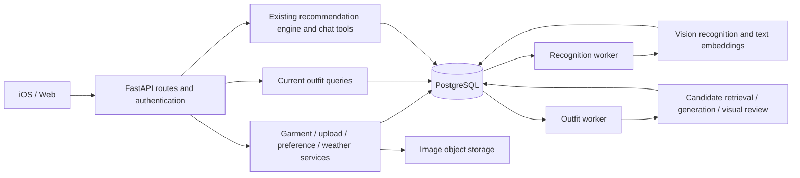

# AI Closet Backend Architecture Guide

For repository readers, project reviewers, and technical interview preparation.

[中文版](BACKEND_GUIDE.zh-CN.md) · [Database design](DATABASE_GUIDE.md)

Updated: 2026-10-09. This guide describes the current source code. Deployment of migrations 008 and 009 must be confirmed separately.

## 1. One-minute overview

> AI Closet is a Python/FastAPI modular monolith with independently running recognition and outfit workers. The API handles authentication, closet management, and result queries. Long-running model work is persisted in database queues and executed by workers. Business services normalize labels, protect user edits, retrieve candidates, and evaluate outfits. Repository, store, and storage adapters isolate persistence and image storage. Experiment versions, human-evaluation exports, and call-level cost records support model iteration.

The deployment model is **one codebase, multiple processes**. The API and workers can run and scale separately while sharing domain models and business modules.

## 2. System structure



**Distinguish the product direction from the current implementation.** The outfit library can become the candidate source for contextual recommendations, but `/recommendations` and `/today/recommendation` still use a separate candidate-generation and scoring engine. They have not all switched to filtering the library. Chat uses a lightweight planner and fixed skills, rather than an autonomously trained recommendation system.

## 3. Modules and responsibilities

Paths below are relative to `backend/`.

| Path | Responsibility | What to inspect |
|---|---|---|
| `app/main.py` | FastAPI assembly, middleware, lifecycle, local file mounts | Work started with the API versus separate processes |
| `app/api/` | HTTP routes, request/response contracts, identity | Boundaries that keep long model jobs out of upload requests |
| `app/models/` | Pydantic domain models and API DTOs | Validation, optional fields, and state meanings |
| `app/core/` | Settings, constants, versions, logging | Environment configuration versus experiment versions |
| `app/services/` | Uploads, edits, recognition, embeddings, weather | User-edit precedence and external failure handling |
| `app/repositories/` | Persistence interfaces and adapters | Ownership, conditional writes, and transaction RPCs |
| `app/outfits/` | Library algorithms, rules, providers, results, and runs | Generation, review, deduplication, projections, and costs |
| `app/services/recommendation/` | Existing recommendation generation and scoring | Its separation from the outfit-library algorithm |
| `app/agent/` | Intent parsing, planning, and fixed skills | How chat invokes existing business capabilities |
| `app/worker.py` | Recognition worker | Batch claiming followed by sequential processing |
| `app/outfit_worker.py` | Concurrent outfit consumers | Per-consumer clients, leases, recovery, and projection refresh |
| `app/outfit_experiments/` | Independent algorithm experiments | Experimental versions versus current production code |
| `sql/migrations/` | Schema evolution and atomic operations | Upgrade order and permissions |
| `tests/`, `tests/sql/` | Unit, workflow, and SQL assertions | Functional correctness and recovery guarantees |

Some research, export, and administration CLIs remain at the top of `app/`; these boundaries could be organized further.

## 4. Technology choices and tradeoffs

| Choice | Rationale | Advantages | Costs and limitations |
|---|---|---|---|
| Python | Shared ecosystem for images, models, evaluation, and APIs | Fast iteration and reusable analysis code | CPU-heavy work needs separate planning; dependencies and performance need measurement |
| FastAPI + Pydantic | Typed, validated API contracts | Clear request/response schemas and OpenAPI export | Does not automatically make synchronous calls nonblocking or provide durable jobs |
| Modular monolith | Shared domain and development workflow | Easier cross-module debugging, refactoring, and testing | Coupling can grow; application and database changes need coordinated releases |
| Separate workers | Model work is slow and failure-prone | Quick upload responses, retries, independent concurrency | Multiple processes to operate; API, worker, and schema versions must be compatible |
| Repository/store adapters | Supabase and local testing need different persistence implementations | Replaceable dependencies and test doubles | Local semantics are not identical to production guarantees |
| httpx + provider boundary | Centralizes external calls and output validation | Easier model replacement and failure simulation | Rate limits, connection reuse, timeouts, and uncertain billing still need explicit handling |
| Configuration + prompt files | Models and admission rules change frequently | Replaceable parameters and run snapshots | Configuration compatibility requires validation; prompt hashes do not replace code versioning |
| OpenAPI + generated TypeScript types | Shares API contracts with the web client | Reduces field drift and enables contract checks | iOS DTOs still need maintenance; types do not guarantee matching business semantics |

Supabase SDK operations and SQL RPCs form the main persistence layer rather than an ORM. This exposes PostgreSQL transaction and locking behavior directly, but Python and SQL business boundaries must be reviewed together.

## 5. Main workflows

### Upload → recognition → usable garment

1. The client uploads an image with identity credentials.
2. The backend validates the user through Supabase Auth and stores the image under a user-owned path.
3. A transaction creates the pending garment and recognition job; the API returns the garment card.
4. A recognition worker claims the job, calls the vision provider, and normalizes categories and multi-select labels.
5. It prepares embeddings, garment updates, a recognition record, and a feature snapshot.
6. Before committing, it checks the garment snapshot and job lease to avoid overwriting newer user actions.
7. The client fetches updated garment state to display the result.

Image storage is outside the database transaction. A successful file upload followed by a failed database write can leave an orphaned object; compensation and cleanup are separate concerns.

### Anchor garment → candidates → outfit library

The library incrementally discovers outfits containing an anchor garment:

1. Exclude candidates using garment roles, clear incompatibility rules, and layering capabilities.
2. Rank using semantic vectors, label similarity, and rule priorities. **This stage does not inspect images.** The default candidate limit is 40, including the anchor.
3. In the default `vision_then_visual` mode, send candidate images and labels to the generation model for up to eight outfits.
4. Apply local structural and compatibility checks, then visually review valid candidates.
5. Review base and full outfits separately. Optional layers must offer a clear visual improvement to be displayed.
6. Reuse evaluations by combination signature, garment revision, and evaluator version. The current projection merges results for frontend queries and pagination.

These limits control cost and search breadth; they do not guarantee exhaustive discovery. Retrieval may miss good combinations across styles, and visual review remains subjective and fallible. Human evaluation is necessary.

Generation and review settings live in `app/outfits/config.json` and `config.py`. Model names, prices, and image-detail settings alone do not establish measured quality or performance.

### Edit labels or images → preserve user intent → refresh outfits

- Opening an item card in iOS confirms the displayed label snapshot.
- Label edits update current state and create manual-edit records.
- The current rotate/crop path preserves labels and vectors without automatically rerunning recognition.
- Changes affecting outfits invalidate the old projection and leave a durable refresh request.
- Workers check job and garment versions so stale snapshots cannot publish new results.

Confirming labels on opening prevents background changes after the user closes the card. It can also preserve a model mistake that the user did not carefully inspect. This is a product tradeoff between predictability and automatic correction.

## 6. Concurrency and recovery

### Background execution modes

| Executor | Current behavior | Implication |
|---|---|---|
| Recognition worker | Claims a batch, then processes jobs sequentially | `batch_size=3` does not mean three simultaneous model requests |
| Outfit worker | Thread-pool consumers; default concurrency 3, configurable from 1–8 | Suited to network waits; greater concurrency increases rate-limit and spending pressure |
| Embedding retry loop | Started by FastAPI lifespan; checks approximately every 30 seconds with a bounded batch | Stops with the API; could become an independent worker later |

HTTP concurrency, job concurrency, and model-call concurrency are separate layers. An async-capable framework does not make every operation parallel.

### Implemented recovery mechanisms

- Persistent queues allow restarted processes to discover unfinished jobs.
- Claim locks and leases support multiple workers and recovery of expired work.
- Conditional writes protect garment versions and user edits.
- Unique keys and caching reduce duplicate stored results and repeated reviews.
- Projection version checks reject stale publication.
- Each model call has its own usage record; calls whose usage cannot be established retain unknown costs.

### Limits of those guarantees

A provider may finish and charge for a request before a network timeout reaches the worker. Retrying can incur another charge. Two concurrent jobs may both request a review before one deduplicated result is stored.

Some recognition failure and stale-job paths still update state separately, with less comprehensive lease protection than successful commits. The frontend depends on refresh behavior and does not necessarily update at the instant a worker finishes. Local tests are not a substitute for production monitoring, load tests, or failure drills.

## 7. Security and observability

With production Supabase configuration, the API requires a Bearer token validated through Supabase `get_user`. Local mode without Supabase permits development user headers or a default user; that convenience is not the production authentication design.

Images use user-owned paths and signed URLs. Privileged backend queries still require explicit ownership filtering because service-role credentials bypass RLS.

The system has request IDs, HTTP timing logs, worker events, queue-health endpoints, and run-level usage reports. This is not yet complete distributed tracing, SLO monitoring, unified alerting, or budget circuit breaking. Log formatting and redaction could also be more consistent.

Recognition and image-enabled outfit generation/review send garment images to model providers. Image processing is not limited to initial recognition.

## 8. Engineering tests versus model evaluation

**Engineering tests** validate state transitions, transactions, rules, deduplication, contracts, and recovery. Examples include:

- [User-confirmation protection](../backend/tests/test_label_confirmation.py).
- [Outfit-library workflows](../backend/tests/test_outfit_library.py).
- [Visual review and optional layers](../backend/tests/test_outfit_visual_review.py).
- [Run accounting and retention](../backend/tests/test_outfit_runs.py).
- [Atomic SQL operations](../backend/tests/sql/008_atomic_current_outfits.sql) and [run SQL assertions](../backend/tests/sql/009_outfit_runs.sql).

**Model evaluation** asks whether an outfit is structurally wearable, aesthetically good, and something the user would wear. Annotation workbooks and comparisons live in `evaluation/`; independent algorithms live in `app/outfit_experiments/`.

Passing unit tests does not validate aesthetic quality. A single user's annotations do not establish preferences across a broader population.

## 9. Strengths, limitations, and next steps

| Area | Existing value | Current limitation | Possible next step |
|---|---|---|---|
| Module boundaries | API, services, persistence, and providers are identifiable | Routes still assemble many dependencies; some orchestration classes are large | Improve dependency injection and split responsibilities by how they change |
| Algorithm iteration | Traceable configuration, prompts, runs, and evaluations | Legacy recommendations coexist with the library and may duplicate rules | Establish a common recommendation data source and compatibility boundary |
| Reliability | Core successful writes are atomic and version-checked | External calls are not atomic; failure-path protection varies | Unify lease checks, compensation, and failure tests |
| Query performance | Current outfit reads avoid repeated history scans | Background rebuilds still scan history; item-list pagination is not uniform | Incremental projections, pagination, and measured index improvements |
| Cost control | Candidate caps, review caching, call-level accounting | No comprehensive hard budgets per user or run | Pre-request budgets, rate limits, and abnormal-spending alerts |
| Operations | CLIs, logs, and independent workers support debugging | Manual numbered SQL deployment; many dependency ranges | Migration checks, reproducible dependency locking, release and rollback validation |

These next steps are proposals, not implemented features.

## 10. Interview preparation

### A two-minute explanation

> The project converts closet photos into editable structured data and uses that data to build a reusable outfit library. I chose a FastAPI modular monolith with separate workers so long-running model calls do not block uploads. Users can edit labels while a model is running, so results must be checked against garment snapshots before being committed. Multiple anchor items can discover the same outfit, which requires combination signatures and version-aware deduplication.
>
> I separated historical evaluations from currently displayed outfits so the frontend can query base outfits and optional layers directly. I also added run records and a model-call ledger so one generation request producing several outfits is charged only once in reports. These choices introduce projection and migration complexity, so SQL transaction assertions and state-transition tests check the boundaries.
>
> Remaining limitations include the legacy recommendation path, full-history background projection rebuilds, and incomplete compensation for external failures. I describe the system as supporting traceability and recovery, rather than claiming proven large-scale throughput or end-to-end exactly-once execution.

### Common follow-up questions

| Question | Suggested answer |
|---|---|
| Why not microservices? | Modules share domain data and a development workflow. Separate workers already isolate slow tasks; further separation should follow operational or organizational needs |
| What does FastAPI async provide? | Support for appropriate asynchronous I/O, but some SDK calls remain synchronous. Workers provide the main separation for long jobs |
| How do you replace a model? | Update the provider, configuration, and output schema; retain run snapshots and run regression evaluations. It is more than changing a model-name string |
| Are model outputs authoritative? | User confirmation takes precedence, and deterministic checks enforce categories, layering, and combination structure |
| How do you track costs? | Account per call, preserve unknown values, and distinguish cache reuse. Do not claim a savings percentage without measurements |
| Is personalization trained? | Current behavior mainly uses explicit preferences, labels, and rules. Edit history supports future learning but does not mean a personalized model has been trained |
| Where are likely bottlenecks? | Provider latency and rate limits, per-user candidate/history scans, and deep pagination; monitoring and load tests must confirm this |

## 11. Reading and running the backend

Suggested reading order:

1. [Application entry point](../backend/app/main.py) and [routes](../backend/app/api/routes.py).
2. [Domain models](../backend/app/models/domain.py) and [repository interface](../backend/app/repositories/base.py).
3. [Upload service](../backend/app/services/upload_service.py) → [recognition pipeline](../backend/app/services/recognition_pipeline.py).
4. [Outfit service](../backend/app/outfits/service.py) → [candidate retrieval](../backend/app/outfits/catalog.py) → [provider](../backend/app/outfits/provider.py).
5. [Outfit worker](../backend/app/outfit_worker.py) and [run tracking](../backend/app/outfits/runs.py).
6. Related tests and migrations to check the documented guarantees.

Follow the [backend README](../backend/README.md) for dependencies and configuration and the [migration instructions](../backend/sql/migrations/README.md) for the matching database schema. From the repository root, start each process in a separate terminal:

```bash
# Run each command in its own terminal; PYTHON can point to your virtual environment.
make backend-dev PYTHON=python
make worker PYTHON=python
make outfit-worker PYTHON=python
```

Engineering checks:

```bash
make backend-test PYTHON=python
make api-contract PYTHON=python
```

Model jobs can incur external API charges. To rebuild the display from existing results without new model calls, use the [projection CLI](../backend/app/refresh_outfit_projection.py). For run reporting and maintenance, use the [run CLI](../backend/app/outfit_runs.py). Additional rollout and maintenance details are available in the [Chinese operations guide](DATA_ARCHITECTURE.zh-CN.md).
