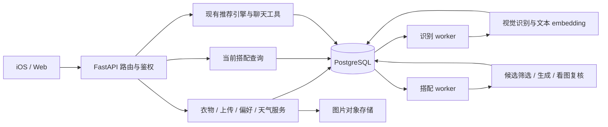

# AI Closet 后端架构介绍

[English version](BACKEND_GUIDE.md)

面向：首次阅读仓库的开发者、项目评审与技术面试。

更新时间：2026-10-09。本文描述当前代码，部署环境是否应用迁移 008/009 需另行确认。数据库详解见[数据库设计介绍](DATABASE_GUIDE.zh-CN.md)。

## 1. 一分钟介绍

> AI Closet 后端是一个 Python / FastAPI 模块化单体，搭配独立运行的识别 worker 和搭配 worker。API 处理鉴权、衣柜管理和结果查询，耗时模型任务持久化到数据库后交给 worker。业务层负责标签规范化、用户修改保护、候选筛选和搭配审核；repository 和 store 封装 PostgreSQL、对象存储及本地适配器。系统还保留实验版本、人工评估导出和按调用记录的成本信息，方便持续调整模型。

这是“一套代码、多个进程”的组织方式。API 与 worker 可以分别部署和调整并发，仍共享领域模型和业务模块。

## 2. 系统结构



**产品目标和当前实现需要区分：** 搭配库未来可作为上下文推荐的候选来源，但现有 `/recommendations` 与 `/today/recommendation` 仍调用独立的候选生成/评分引擎；它们尚未全部切换成“从搭配库筛选”。聊天运行时也是轻量 planner + 固定技能执行，不是一个自主训练的推荐系统。

## 3. 目录与模块职责

| 路径 | 主要职责 | 读代码时关注什么 |
|---|---|---|
| `app/main.py` | FastAPI 装配、中间件、生命周期、本地文件挂载 | 哪些工作随 API 启动，哪些需要独立进程 |
| `app/api/` | HTTP 路由、请求响应、用户身份、接口边界 | 避免把长时间模型任务塞进上传请求 |
| `app/models/` | Pydantic 领域模型与 API DTO | 输入校验、类型、可选字段、状态含义 |
| `app/core/` | 设置、常量、版本、日志 | 环境与实验版本如何区分 |
| `app/services/` | 上传、衣物编辑、识别、embedding、天气等业务 | 用户修改优先级、外部服务失败如何处理 |
| `app/repositories/` | 衣物、任务、审计与偏好的持久化接口和适配器 | 用户归属、条件更新、事务 RPC |
| `app/outfits/` | 当前搭配库算法、规则、模型提供方、结果与批次存储 | 生成、审核、去重、投影和成本的边界 |
| `app/services/recommendation/` | 原有推荐候选生成、规则、评分 | 与搭配库算法是两条路径 |
| `app/agent/` | 意图解析、计划与固定技能调用 | 聊天如何调用现有业务能力 |
| `app/worker.py` | 衣物识别 worker | 一批领取后逐个处理 |
| `app/outfit_worker.py` | 搭配 worker 与并发消费者 | 每个消费者独立客户端、租约、恢复与投影刷新 |
| `app/outfit_experiments/` | 独立算法实验版本 | 实验版本与生产实现不应混为一谈 |
| `sql/migrations/` | 数据库演进与原子业务操作 | 升级顺序与权限 |
| `tests/`、`tests/sql/` | 单元、流程和 SQL 断言 | 功能正确性与并发/恢复保证 |

部分研究、导出与管理 CLI 仍位于 `app/` 顶层，目录边界还有整理空间。

## 4. 技术选型与优缺点

| 技术 / 设计 | 选用原因 | 优点 | 缺点 / 代价 |
|---|---|---|---|
| Python | 图像、模型、数据评估与后端共用生态 | 原型迭代和分析脚本容易复用 | CPU 密集计算需要另外安排；依赖隔离与性能测量很重要 |
| FastAPI + Pydantic | 有明确的 API 类型和校验需求 | 请求响应约束清晰，可导出 OpenAPI | 框架不会自动让同步外部调用变为非阻塞，也不自动提供任务持久化 |
| 模块化单体 | 当前领域与团队规模适合共享模型和代码 | 跨模块调试、重构和测试路径较短 | 模块之间容易耦合；代码与数据库协议需要协调发布 |
| 独立 worker | 视觉调用、搭配生成耗时且可能失败 | 上传可以快速返回，后台可重试和独立扩容 | API、worker、数据库迁移必须版本兼容，需要运维多个进程 |
| Repository / store 适配器 | 同一业务需要连接 Supabase 和本地测试环境 | 便于替换依赖、注入测试桩 | 本地与线上存储语义不同，测试通过不代表生产完全等价 |
| httpx + provider 边界 | 集中封装外部调用和模型输出校验 | 模型替换与故障模拟更容易 | 限流、连接重用、超时及未知计费结果仍要自行处理 |
| 配置文件 + prompt 文件 | 模型、筛选规则持续调整 | 参数可替换，批次能保存配置快照 | 配置兼容性要校验；prompt hash 不能替代完整代码版本管理 |
| OpenAPI + TypeScript 类型生成 | Web 与后端共享接口 | 减少字段漂移，可将契约检查纳入流程 | iOS DTO 仍需维护；生成类型不会保证业务语义一致 |

本项目将多数数据库关系操作封装在 Supabase SDK 和 SQL RPC 中，没有把 ORM 作为主要持久化层。这样能直接表达 PostgreSQL 锁和事务，但 Python 与 SQL 的业务边界需要一起评审。

## 5. 三条主要数据流

### 5.1 上传 → 识别 → 用户可用的衣物

1. 客户端发送带身份凭据的图片上传请求。
2. 后端通过 Supabase Auth 解析并验证用户，图片存储到用户路径。
3. 以事务创建待识别衣物和识别任务，立即返回衣物卡片。
4. 识别 worker 领取任务、调用视觉服务、规范化类别与多选标签。
5. 生成向量并准备当前衣物更新、识别记录和特征快照。
6. 提交前检查衣物快照与任务租约，避免覆盖更新的用户操作。
7. 客户端再次获取衣物状态后显示结果。

图片存储发生在数据库事务之外，因此上传文件成功而数据库写入失败时仍可能留下孤立文件；文件补偿与清理是需要单独考虑的边界。

### 5.2 单品 → 候选 → 搭配库

以一件衣物为 anchor，增量寻找包含它的搭配：

1. 根据品类角色、明确不兼容规则和叠穿能力排除候选。
2. 使用语义向量、标签相似度和规则优先级排序。**这一阶段不看图片**；配置默认候选上限为 40，包含 anchor。
3. 当前默认 `vision_then_visual` 模式把候选图片和标签交给模型，最多生成 8 套。
4. 先做本地结构与兼容性校验，再对有效候选进行看图复核。
5. 复核分别判断基础搭配和完整搭配；可选叠穿必须有明确的视觉改善才展示。
6. 结果按组合签名、衣物版本和审核器版本复用，当前展示投影负责合并和分页。

数量上限是成本控制和搜索范围控制，不保证找到所有可能的好搭配。初筛可能漏掉跨风格的优秀组合；图像复核仍存在主观性与误判，需要人工评估验证。

生成与复核模型目前由 `app/outfits/config.json` 和 `config.py` 控制。本文不以模型型号、价格或调用精度推导未经实测的效果结论。

### 5.3 编辑标签 / 图片 → 保护用户意图 → 刷新搭配

- 用户打开衣物卡片时，iOS 会确认显示的标签快照。
- 标签修改作为人工变更保存，更新当前数据并记录修改事件。
- 当前图片旋转/裁剪路径保留标签和向量，不自动重新识别。
- 影响搭配的衣物变化使旧投影失效，并留下持久化刷新请求。
- worker 重新检查相关任务与衣物版本，新结果不能基于已过期的快照发布。

“打开就确认”能避免用户关闭卡片后标签被后台悄悄改掉，但也可能把用户未仔细检查的模型结果固定下来。这是明确的产品取舍，需要在用户体验与自动纠错之间权衡。

## 6. 并发、恢复和边界

### 三种后台执行方式

| 执行器 | 当前行为 | 需要注意 |
|---|---|---|
| 识别 worker | 领取一批后依次处理 | `batch_size=3` 不等于三个模型请求同时运行 |
| 搭配 worker | 线程池消费者，默认并发 3，可配置 1–8 | 主要适合网络等待；提高并发会增加限流与费用压力 |
| embedding 补偿循环 | FastAPI lifespan 启动，约每 30 秒检查，每次处理有限数量 | API 停止时它也停止；未来可迁移为独立 worker |

HTTP 请求、worker 和模型调用是不同的并发层。不能仅因为框架支持 async，就声称所有业务都并行执行。

### 可依赖的机制

- 数据库队列使进程重启后仍能发现任务。
- 领取锁和租约支持多 worker 协作与过期任务回收。
- 条件写入保护用户编辑和衣物版本。
- 唯一键与缓存减少重复结果写入和重复复核。
- 当前投影的版本检查拒绝过期发布。
- 每次模型调用单独记录用量；恢复后无法确认的调用保持未知费用。

### 不应夸大的保证

- 网络超时可能发生在服务商完成并计费之后；重试可能再次收费。
- 两个并发任务可能都发出了复核请求，随后只保存一份去重结果。
- 部分识别失败/过期分支仍采用独立状态更新，租约保护并非所有路径都一样完整。
- 前端展示依赖状态刷新，不保证后台完成瞬间就更新屏幕。
- 所有关键路径都需要线上异常观测；本地测试不能替代真实负载与故障演练。

## 7. 安全与可观测性

生产配置下，API 要求 Bearer token，通过 Supabase `get_user` 验证。无 Supabase 的本地模式允许开发用用户头或默认用户，这个便利不应被描述为生产鉴权方案。

对象按用户路径存储，并使用签名 URL 返回。后端高权限数据库客户端需要显式用户过滤，RLS 不是 service-role 路径的自动兜底。

已有请求 ID、HTTP 耗时日志、worker 事件、队列健康接口、批次用量统计。尚不能据此声称已具备完整的分布式链路追踪、SLO、统一指标告警或费用预算熔断；日志的格式与脱敏也应继续统一。

视觉识别以及配置为看图的搭配生成/复核会把衣物图片提供给模型服务；不能说图片只会在最初识别时离开存储。

## 8. 测试与评估：两件不同的事

**工程测试**检查状态、事务、规则、去重、接口和恢复，例如：

- [人工确认保护](../backend/tests/test_label_confirmation.py)。
- [搭配库流程](../backend/tests/test_outfit_library.py)。
- [视觉复核与可选层](../backend/tests/test_outfit_visual_review.py)。
- [批次计费与保留](../backend/tests/test_outfit_runs.py)。
- [SQL 事务断言](../backend/tests/sql/008_atomic_current_outfits.sql)与[批次断言](../backend/tests/sql/009_outfit_runs.sql)。

**模型评估**检查穿搭是否结构可穿、是否好看、用户是否愿意穿。人工标注工作簿和方法比较放在 `evaluation/`，独立算法代码在 `app/outfit_experiments/`。通过单元测试不代表搭配审美已验证；单个用户的标注也不代表整体人群偏好。

## 9. 目前的优点、缺点与演进方向

| 方面 | 已有价值 | 当前不足 | 合理的后续方向 |
|---|---|---|---|
| 业务分层 | API、服务、持久化、模型边界基本可辨认 | 路由模块仍集中构造依赖，部分编排类较大 | 明确依赖注入和模块职责，按变化频率拆分 |
| 算法迭代 | 配置、prompt、批次、审计记录可追溯 | 旧推荐与搭配库并存，规则可能重复 | 明确统一的推荐数据入口与兼容边界 |
| 数据可靠性 | 核心成功路径原子提交，保存时检查版本 | 外部服务不原子，失败分支保护仍可加强 | 统一租约校验、补偿流程与故障测试 |
| 查询性能 | 当前搭配查询不再逐次扫描审核历史 | 后台重建仍全量扫描，衣物列表接口未统一分页 | 增量投影、分页与基于实测的索引优化 |
| 成本控制 | 候选限制、审核缓存、调用级费用统计 | 尚未形成按用户/批次的强预算限制 | 请求前预算与限流、异常消费告警 |
| 运维 | CLI、日志、独立 worker 便于调试 | 编号 SQL 手动发布，依赖版本多用范围约束 | 自动迁移检查、可重复依赖锁定、发布与回滚验证 |

这些是演进建议，不是仓库已经实现的功能。

## 10. 面试时怎样讲

### 两分钟叙述

> 项目的核心是把衣柜图片变成可以编辑和计算的结构化数据，再生成可复用的搭配库。我采用 FastAPI 模块化单体和独立 worker，把长时间模型调用从上传请求中分离。因为用户可能在模型执行时修改标签，写回前必须检查衣物快照；因为同一搭配可能由多个单品发现，还需要组合签名和版本去重。
>
> 后来我把历史审核和前端当前搭配分开，前端直接查询整理后的基础搭配与可选层。同时增加批次和调用账本，避免一条生成请求输出多套搭配时重复计算费用。这个设计的代价是多了投影、迁移和一致性维护，所以我用 SQL 事务测试和状态测试验证边界。
>
> 目前仍有旧推荐路径、全量后台投影和不完整的外部故障补偿。因此我把它描述为具备可追溯和恢复机制的迭代型系统，而不会声称已经验证大规模吞吐或端到端 exactly-once。

### 常见追问

| 问题 | 回答重点 |
|---|---|
| 为什么不用微服务？ | 当前模块共享领域数据与开发流程；独立 worker 已能隔离耗时任务，拆服务应有规模与组织依据 |
| FastAPI 的 async 带来了什么？ | 支持合适的异步 I/O，但当前仍有同步 SDK；长任务主要通过 worker 分离解决 |
| 怎样替换模型？ | 调整 provider、配置和输出 schema，保留批次快照；仍需做回归评估，不是只换一个型号字符串 |
| 模型结果是最终权威吗？ | 用户确认优先；类别、叠穿和组合结构还有确定性校验 |
| 如何处理成本？ | 按调用统计、保留未知费用、缓存复用；没有数据时不宣称具体节省百分比 |
| 是否训练了个性化模型？ | 当前主要使用显式偏好、标签和规则，人工修改提供未来学习数据；不要把数据积累等同于训练完成 |
| 瓶颈可能在哪里？ | 外部模型耗时与限流、每用户候选/历史扫描、深分页；需要监控和压测确认 |

## 11. 新读者的代码阅读和运行路线

阅读顺序：

1. [入口](../backend/app/main.py)与[路由](../backend/app/api/routes.py)。
2. [领域模型](../backend/app/models/domain.py)与[repository 协议](../backend/app/repositories/base.py)。
3. [上传服务](../backend/app/services/upload_service.py) → [识别流水线](../backend/app/services/recognition_pipeline.py)。
4. [搭配服务](../backend/app/outfits/service.py) → [候选筛选](../backend/app/outfits/catalog.py) → [provider](../backend/app/outfits/provider.py)。
5. [独立搭配 worker](../backend/app/outfit_worker.py)与[批次记录](../backend/app/outfits/runs.py)。
6. 对照相关测试和数据库迁移验证设计。

依赖安装和配置见[后端 README](../backend/README.md)。执行匹配的数据库迁移后，从仓库根目录分别启动：

```bash
# 不同终端分别运行；PYTHON 可指向你的虚拟环境。
make backend-dev PYTHON=python
make worker PYTHON=python
make outfit-worker PYTHON=python
```

工程验证：

```bash
make backend-test PYTHON=python
make api-contract PYTHON=python
```

模型任务可能产生外部 API 费用。只重建现有搭配展示数据时，使用[无模型调用的投影 CLI](../backend/app/refresh_outfit_projection.py)。批次查询和维护使用[批次 CLI](../backend/app/outfit_runs.py)。SQL 部署与维护顺序见[数据架构与迁移说明](DATA_ARCHITECTURE.zh-CN.md#8-运行与上线)。
