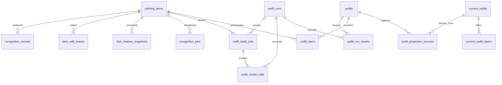

# AI Closet Database Design Guide

For repository readers, project reviewers, and technical interview preparation.

[中文版](DATABASE_GUIDE.zh-CN.md) · [Backend architecture](BACKEND_GUIDE.md)

Updated: 2026-10-09. This guide describes the repository and migrations 001–009. **Implemented in code does not mean deployed:** confirm that migrations 008 and 009 have been applied to the target database. See the [migration instructions](../backend/sql/migrations/README.md).

## 1. One-minute overview

> AI Closet uses Supabase PostgreSQL to manage garments, recognition results, user edits, and outfits. It separates current garment state, historical outfit evaluations, and the outfits currently displayed to users. Long-running work is stored in database queues, with leases and version checks supporting retries and concurrent edits. Experiment configuration is captured per run, while usage and estimated costs are recorded per model call, making model comparisons and spending traceable.

The central challenges are that **user edits can race with asynchronous model results**, and **the same garment or outfit can have multiple versions**. These concerns drive the schema.

## 2. Technology choices and tradeoffs

| Choice | Why it fits | Advantages | Costs and limitations |
|---|---|---|---|
| PostgreSQL | Users, garments, outfits, and jobs have explicit relationships and require coordinated writes | Foreign keys, unique constraints, transactions, and SQL aggregation | Schema migrations and indexes need maintenance; the database can become a shared bottleneck |
| Supabase | Integrates Auth, PostgreSQL, and Storage | Less initial infrastructure work; accessible data inspection and RLS configuration | Provider and SDK dependencies; privileged server credentials require isolation |
| Relational columns + JSONB | Core identities and states are stable; model output evolves | Clear queries with extensible evidence and metadata | Weaker constraints inside JSON; application-managed duplicate fields can drift |
| pgvector | Vectors belong to the same entities as garment metadata | Keeps vectors, ownership, and versions together | Storing vectors does not establish database ANN retrieval; some similarity calculations still run in Python |
| Object storage for images | Images have a different lifecycle from structured records | Avoids duplicating image bytes across business tables | Storage operations are outside PostgreSQL transactions |
| Database-backed queues | Jobs need durability, retries, and bounded concurrency | Can enqueue work alongside business writes without another infrastructure service | Polling, lock contention, and cleanup require attention; large-scale throughput remains to be evaluated |
| SQL RPCs + numbered migrations | Multiple Supabase SDK HTTP writes do not form one transaction | Explicit atomic boundaries and directly testable database guarantees | Business logic spans Python and SQL; deployment order must be managed |

There is currently no separate message broker or vector service. Introducing one should follow measured workload requirements; this repository does not provide comparative load benchmarks for those alternatives.

## 3. Schema organized by responsibility

### Users and garments

| Table | Contents | Reason for separation |
|---|---|---|
| `user_preferences` | User profile, preferences, and settings | User-level state should not be repeated on every garment |
| `clothing_items` | Current labels, material, lengths, image paths, vectors, and recognition state | Provides the effective garment state for the UI and algorithms |
| `recognition_records` | Model or manually corrected analysis records, versions, normalized output, and audit metadata | Re-recognition should not erase previous results |
| `item_edit_events` | Changed fields, before/after values, and operation source | Preserves user intent for analysis and future personalization |
| `item_feature_snapshots` | Versioned feature vectors and additional features | Supports comparison of feature-processing versions |
| `recognition_jobs` | Job status, attempts, leases, and errors | Separates upload completion from model processing |

One garment can have many recognition records, edit events, and feature snapshots. `recognition_records` does not guarantee that every path stores the complete raw provider response; inspect the relevant write path when analyzing historical data.

### Outfits: history versus current display

| Table or view | Responsibility |
|---|---|
| `outfits` | Historical evaluations identified by outfit signature, garment revision, and evaluator version |
| `outfit_items` | Many-to-many relationships between historical outfits and garments |
| `current_outfits` | Base outfits currently displayed in the frontend |
| `current_outfit_layers` | Optional layers associated with a base outfit |
| `outfit_projection_sources` | Historical evaluations supporting each current base outfit |
| `outfit_evaluation_index` | Query view exposing review status and `is_current` |
| `outfit_refresh_requests` | Per-user source version, published version, and pending refresh state |
| `outfit_build_jobs` | Generation jobs anchored on individual garments |
| `outfit_libraries` | Legacy library-enrollment records retained for compatibility |

For example, “white shirt + black skirt” may be discovered by several anchor jobs and evaluated by several model versions. Multiple historical evaluations can still correspond to one displayed base outfit. A compatible coat can be an optional layer instead of creating another base outfit.

The `current_*` tables are an application-maintained **read model, or projection**. They are physical tables rebuilt by a worker and published through an RPC, not PostgreSQL materialized views.

### Experiments and costs

| Table or view | Responsibility |
|---|---|
| `outfit_runs` | Algorithm, models, prompt hashes, full configuration snapshot, and pinning for a batch of new jobs |
| `outfit_model_calls` | Call stage, attempt, status, duration, token usage, and estimated cost |
| `outfit_run_results` | Links a run to generated or cached evaluation results |
| `outfit_run_summary` | Aggregates job progress, calls, tokens, costs, and results |
| `data_retention_policies` | Retention behavior, periods, and rationale |
| `history_maintenance_runs` | Records maintenance previews and executions |

A **run**, **job**, **model call**, and **outfit result** are different entities. A run contains multiple anchor jobs. A job can invoke generation and review, and one generation call can produce multiple outfits.

The diagram omits common user-ownership relationships and membership stored in JSON or arrays. Legacy jobs may have no `run_id`; the system does not invent historical experiment metadata.

## 4. Design decisions and their rationale

### Separate current state from history

Overwriting a garment with every model response loses the distinction between what the model predicted and what the user corrected. Current-state tables serve the product; historical tables support explanation, evaluation, and debugging.

The benefit is traceability. The cost is coordinated writes across multiple tables, requiring explicit transaction boundaries. This is not full event sourcing: current records are directly updated, and historical events are not guaranteed to reconstruct the entire system through replay.

### Combine typed columns with JSONB

User IDs, job states, and version keys use explicit columns. Prompts, detailed review evidence, and edit values use JSONB. Review statuses are exposed through generated database columns rather than manually maintaining duplicate values.

For example, `core_review_status` supports indexed filtering while detailed incompatibility evidence stays in JSON. Legacy numerical scores are not automatically interpreted as passing the newer visual review.

### Deduplicate by signature and version

Sorting garment IDs produces an order-independent combination signature: “shirt, skirt” and “skirt, shirt” identify the same combination. Evaluations also include garment-content and evaluator versions.

The unique key `user_id + signature + revision + evaluator_key` prevents duplicate evaluation records under the same conditions. It cannot stop two concurrent workers from calling a model before either saves its result. Both actual calls must still be accounted for.

### Query a current outfit projection

The projection resolves deduplication, admission rules, base outfits, and optional layers before serving reads. The API filters and paginates in the database and signs image URLs only for the requested page.

This avoids scanning all evaluation history for every frontend request. The tradeoff is derived state, refresh logic, and a short eventual-consistency window. Background rebuilding still scans a user's evaluation history; incremental projection updates are a future optimization. OFFSET pagination can also become expensive for deep pages.

### Account for model calls independently

If one generation call returns eight outfits, its generation cost must be counted once. A cached evaluation must not create a fictitious review charge, while concurrent duplicate requests must retain their actual usage.

Cost estimates use the run's pricing snapshot. Missing usage or pricing remains NULL rather than being treated as zero. Configuration snapshots reproduce configuration conditions; they do not guarantee identical model output or restore replaced image files.

## 5. Consistency, recovery, and authorization

Core successful write paths use SQL RPCs:

1. `create_item_with_records` creates the garment and recognition job together.
2. `commit_item_change` checks the expected garment state and commits changes with related audit records; recognition commits also check the job lease.
3. `save_outfit_evaluation_checked` revalidates the outfit job lease and garment snapshots before saving.
4. `publish_current_outfits` atomically publishes a projection only if the source version has not changed.

Garment-change triggers invalidate affected current outfits and leave a versioned refresh request. This is a durable notification coalesced per user, similar to a transactional outbox, but it does not preserve a separate message for every mutation.

**Transactions cover PostgreSQL operations.** Model APIs, object storage, and frontend refreshes are outside that boundary. Recovery relies on leases, retries, version checks, and idempotent result storage—not end-to-end exactly-once execution. Some recognition failure and stale-job branches still use separate writes and could benefit from stronger, unified lease checks.

Business records have user ownership. RLS protects direct client access, but backend service-role credentials can bypass RLS. Backend queries therefore need explicit `user_id` filtering, and RPCs must validate ownership. Enabling RLS alone does not secure every privileged server path.

## 6. Retention and practical limits

- New results reference run configuration instead of repeatedly embedding prompts and configuration.
- Repeated requests for an existing job do not continually create empty runs.
- Raw call-usage JSON is eligible for compaction after 180 days by default; maintenance defaults to preview mode.
- Token and cost counters, review evidence, user edits, and feature history are retained by default.
- Pinned runs are excluded from compaction. There is no automatic scheduled deletion of experiment data.

This reduces duplication and makes maintenance controlled; it does **not** eliminate all unbounded historical growth. Future archival of detailed outputs would need checksums, dependency checks, and restoration tools.

The local JSON garment repository is a development adapter, not a substitute for PostgreSQL's cross-table crash atomicity. Local SQL integration verification used text placeholders for unchanged vector columns; it does not establish production pgvector performance or compatibility under load.

## 7. Interview questions

| Question | Evidence-based answer |
|---|---|
| Why not store everything as JSON? | Identity, ownership, and state need constraints, relationships, and indexes; flexible model evidence fits JSON |
| Why so many tables for an outfit? | Historical evaluations, displayed base combinations, optional layers, and experiment membership have different lifecycles and cardinalities |
| Does ACID prevent duplicate model execution? | No. ACID protects database transactions; leases and idempotent writes reduce the impact of external retries |
| Why derive current status instead of independently storing `is_current`? | Current membership depends on projection relationships and policy; deriving it avoids stale standalone flags |
| Why not keep only the highest-scoring result? | Failure evidence, model comparisons, and annotation need history; admission is not based on one score alone |
| What if the user edits an item while a model runs? | Expected snapshots and version checks reject stale writes; affected displayed outfits are invalidated and rebuilt |
| What should be optimized as data grows? | Incremental projections, deep pagination, exact counts, worker scans, and measured vector-index needs |
| Is this full CQRS? | It adopts separate read/write models within one database, without a complete independent command/event infrastructure |

## 8. Suggested code-reading order

1. [Domain models](../backend/app/models/domain.py): garments, analyses, events, and jobs.
2. [Schema](../backend/sql/schema.sql) and [migration instructions](../backend/sql/migrations/README.md): constraints and evolution.
3. [Migration 008](../backend/sql/migrations/008_atomic_items_and_current_outfits.sql): transactions and current projections.
4. [Migration 009](../backend/sql/migrations/009_outfit_runs_and_retention.sql): runs, accounting, statuses, and retention.
5. [Supabase repository](../backend/app/repositories/supabase_closet_repository.py): Python-to-database operations.
6. [Outfit store](../backend/app/outfits/store.py) and [run store](../backend/app/outfits/run_store.py): persistence and reporting.
7. [SQL assertions for 008](../backend/tests/sql/008_atomic_current_outfits.sql) and [009](../backend/tests/sql/009_outfit_runs.sql): executable checks of database guarantees.

Continue with the [Backend Architecture Guide](BACKEND_GUIDE.md). A more detailed [migration and operations guide is available in Chinese](DATA_ARCHITECTURE.zh-CN.md).
