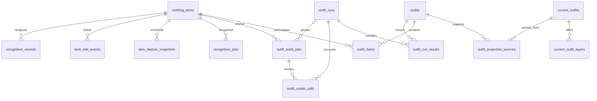

# AI Closet 数据库设计介绍

[English version](DATABASE_GUIDE.md)

面向：首次阅读仓库的开发者、项目评审与技术面试。

更新时间：2026-10-09。本文对应仓库代码和迁移 001–009；**代码已实现不等于线上已部署**，008/009 的线上执行状态需单独确认。操作步骤见[数据架构与迁移说明](DATA_ARCHITECTURE.zh-CN.md#8-运行与上线)。

## 1. 一分钟介绍

> AI Closet 使用 Supabase PostgreSQL 管理用户衣物、模型识别、人工修改和搭配结果。设计上区分衣物当前状态、历史审核和前端当前搭配：用户查询当前表，模型输出保留在历史表中。耗时任务用数据库队列持久化，以租约和版本校验处理重试与并发修改。对于 AI 实验，配置按批次冻结，费用按模型调用记录，使结果比较和成本分析有可追溯的数据来源。

这个项目的难点是**用户修改和异步模型结果并发到达**，以及**同一件衣物、同一套搭配会存在多个版本**。数据库设计围绕这两个问题展开。

## 2. 技术选型与取舍

| 选择 | 为什么适合本项目 | 优点 | 缺点 / 代价 |
|---|---|---|---|
| PostgreSQL | 用户、衣物、搭配、任务有明确关系，多个写入需要共同成功 | 外键、唯一约束、事务、SQL 聚合可以共同维护一致性 | 表结构与迁移需要维护；索引增加写入成本，数据库可能成为共享瓶颈 |
| Supabase | 把 Auth、Postgres、Storage 集成到同一开发工作流 | 减少早期基础设施工作，可直接检查数据和 RLS | 依赖供应商服务与 SDK；服务端高权限密钥必须妥善隔离 |
| 关系列 + JSONB | 核心身份、状态稳定，模型输出结构变化快 | SQL 查询明确，详细模型证据仍可扩展 | JSON 内部约束较弱；重复字段若靠应用双写容易不一致 |
| pgvector | 衣物标签与向量属于同一业务实体 | 向量和权限、版本一起管理，减少跨系统同步 | 存储向量不代表已实现数据库 ANN 检索；目前部分相似度计算仍在 Python |
| 对象存储保存图片 | 图片文件与结构化业务数据生命周期不同 | 不必在多张业务表中重复存储图片字节 | 图片上传与数据库提交不能靠同一个 PostgreSQL 事务覆盖 |
| 数据库队列 | 当前任务需要持久化、重试和有限并发 | 可以结合业务数据做事务写入，组件数量少 | 轮询、锁竞争、状态清理需要维护；大规模任务负载要进一步评估 |
| SQL RPC + 编号迁移 | Supabase SDK 的多次 HTTP 写入不是一个事务 | 原子边界明确，可以直接测试 SQL 约束 | 业务逻辑分布在 Python 与 SQL；目前迁移执行仍需要流程管理 |

当前没有引入独立消息代理或独立向量服务。是否拆分应由任务吞吐、检索规模和监控数据决定，仓库尚未提供这些服务的压测对比。

## 3. 数据结构：按业务职责阅读

### 3.1 用户与衣物

| 表 | 保存什么 | 为什么独立 |
|---|---|---|
| `user_preferences` | 用户资料、偏好、设置 | 用户级状态不应重复写进每件衣物 |
| `clothing_items` | 每件衣物的当前标签、材质、长短、图片路径、向量、识别状态 | 给前端和后续算法提供当前有效状态 |
| `recognition_records` | 模型/人工修正的分析记录、版本、标准化输出和审计信息 | 重识别不能抹掉以前的结果，方便追溯 |
| `item_edit_events` | 哪些字段被用户修改、修改前后值、操作来源 | 明确用户意图，为分析与未来个性化学习留下依据 |
| `item_feature_snapshots` | 特征向量和额外特征的版本快照 | 比较特征处理方式时需要历史切片 |
| `recognition_jobs` | 识别任务的状态、尝试次数、租约与错误 | 上传返回和模型处理可以分开执行 |

一件衣物对应多个识别记录、修改事件和特征快照。`recognition_records` 不应被理解成“所有调用都完整保存了原始供应商响应”；具体保存的内容以写入路径为准。

### 3.2 搭配：历史与当前状态

| 表 / 视图 | 职责 |
|---|---|
| `outfits` | 带签名、衣物版本、审核器版本的历史审核结果 |
| `outfit_items` | 历史搭配和衣物之间的多对多关系 |
| `current_outfits` | 当前前端展示的基础搭配 |
| `current_outfit_layers` | 基础搭配的可选叠穿方案 |
| `outfit_projection_sources` | 当前基础搭配引用哪些历史审核记录 |
| `outfit_evaluation_index` | 审核状态与 `is_current` 的查询视图 |
| `outfit_refresh_requests` | 用户的数据源版本、已发布版本及待刷新状态 |
| `outfit_build_jobs` | 以单品为起点的生成任务 |
| `outfit_libraries` | 旧版搭配库启用登记，暂时保留兼容 |

例如，同一个“白衬衫＋黑裙子”会被多个单品任务发现，也可能被多个模型版本审核。历史结果可以有多条，前端仍应是一套基础搭配。外套属于该基础搭配的可选层，不必重复算成一套基础组合。

`current_*` 是应用维护的**读模型 / 投影（read model / projection）**，并非 PostgreSQL `MATERIALIZED VIEW`。它是实体表，由 worker 重建并通过 RPC 发布。

### 3.3 实验与成本

| 表 / 视图 | 职责 |
|---|---|
| `outfit_runs` | 一批新任务的算法、模型、prompt 哈希、完整配置快照、实验保护标记 |
| `outfit_model_calls` | 一次调用的阶段、尝试次数、状态、耗时、token、费用估算 |
| `outfit_run_results` | 批次与生成或缓存复用结果的关系 |
| `outfit_run_summary` | 任务进度、调用数、token、费用与结果数的汇总视图 |
| `data_retention_policies` | 数据集的保留方式、期限和说明 |
| `history_maintenance_runs` | 维护预览与执行记录 |

“批次”“任务”“模型调用”“搭配结果”不是同一个概念。一个批次有多个单品任务，一个任务会调用生成和复核模型，一次生成又可能输出多套搭配。

图省略所有表共有的用户归属，以及 JSON/数组内保存的成员信息。旧任务允许没有 `run_id`，避免伪造历史批次。

## 4. 几个关键设计，为什么这样做

### 当前状态和历史分开

直接把模型结果覆盖到衣物上，会丢失“模型错了什么、用户改了什么”。当前状态表负责产品使用，历史表负责解释、评估与调试。

优点是职责清楚、容易比较版本；代价是一次业务变化涉及多张表，需要明确哪些记录必须事务提交。

这也不是完整的 Event Sourcing：当前状态仍然被直接更新，历史事件并未承诺可完整重放并恢复整个系统。

### 关系列和 JSONB 配合

用户 ID、任务状态、版本键等使用明确字段。prompt、详细审核理由、修改前后值使用 JSONB。审核状态从 JSON 生成数据库列，避免人工双写。

例如 `core_review_status` 可以用于索引筛选，而具体哪个单品不兼容仍保留在 JSON 证据中。旧版数字评分不会被直接解释成新版视觉审核通过。

### 用签名和版本去重

衣物 ID 排序后生成组合签名，使“先衬衫后裙子”和“先裙子后衬衫”得到同一组合身份。审核结果还带衣物内容版本与审核器版本。

数据库唯一约束 `user_id + signature + revision + evaluator_key` 防止相同条件下重复存储审核。它不能阻止两个并发 worker 在入库前都调用模型，因此实际调用仍必须各自记账。

### 前端读取当前搭配投影

当前展示表把去重、审核策略、基础搭配与可选层提前整理好。API 在数据库中筛选并分页，只对当前页面的图片生成访问地址。

收益是读请求不必每次扫描所有历史。代价是增加派生表和刷新逻辑，存在短暂的最终一致性窗口。后台重建目前仍扫描用户审核历史；数据继续增长时需要考虑增量投影。当前是 OFFSET 分页，深页查询也有优化空间。

### 单独记录模型调用

一次生成输出 8 套，生成费用只能计一次。结果缓存复用不应产生一次虚构的复核费用；并发重复请求则必须保留各自的实际用量。

费用使用批次价格快照估算。缺少用量或价格时保留 NULL，不能把未知当作免费。配置快照有助于重现配置条件，但不保证逐字重现模型输出或还原已被替换的照片。

## 5. 一致性、恢复与权限

核心成功路径通过 SQL RPC 提交：

1. `create_item_with_records`：衣物与识别任务共同写入。
2. `commit_item_change`：检查预期衣物状态，将更新与相关审计记录一起提交；识别提交还检查任务租约信息。
3. `save_outfit_evaluation_checked`：提交前重新检查搭配任务租约和衣物快照。
4. `publish_current_outfits`：只有数据源版本未变化时，才能原子发布新投影。

衣物修改的触发器会撤下受影响的当前搭配，并留下版本化刷新请求。这是按用户合并的持久化通知，功能上类似 transactional outbox，但不保存每一次变化的独立消息。

**事务覆盖 PostgreSQL 内部的操作。** 模型 API、图片对象存储和前端刷新不在同一个事务内。当前处理方式是租约、重试、版本校验和幂等结果保存，而不是端到端 exactly-once。识别的一些失败/过期分支仍使用独立写入，后续可以继续统一状态提交和租约保护。

每条业务数据按用户归属。RLS 保护客户端直接访问；后端 service-role 可绕过 RLS，因此后端仍必须显式检查 `user_id`，RPC 也需要校验对象归属。不能把“开了 RLS”当成所有服务端路径自动安全。

## 6. 保留策略与现实限制

- 新结果引用批次配置，减少重复 prompt 和配置存储。
- 同一个已存在的任务不会仅因重复点击而不断新建空批次。
- 调用原始用量 JSON 默认 180 天后可压缩；默认操作仅预览。
- token、费用计数、审核证据、人工修改、特征历史默认保留。
- `pinned` 批次跳过压缩；当前没有自动定时删除实验数据。

因此这个版本解决的是重复存储和可控维护，**没有解决所有历史数据的无限增长**。以后归档详细模型输出时，还需要校验和、依赖检查和恢复工具。

本地 JSON 衣物仓库只用于开发，不具备 PostgreSQL 跨表事务的崩溃原子性。迁移 SQL 的测试环境也不等于线上 Supabase；已有本地集成验证对未改动的向量列使用了 text 替代，不能声称完成了真实 pgvector 运算的生产压测。

## 7. 面试常见追问

| 问题 | 可据代码回答的重点 |
|---|---|
| 为什么不全存 JSON？ | 身份、归属、状态需要约束、关联和索引；模型证据适合 JSON，两者各司其职 |
| 为什么一套搭配有多张表？ | 历史审核、前端基础组合、可选层、实验归属的生命周期和基数不同 |
| 数据库 ACID 能防止模型重复执行吗？ | 不能。ACID 保护数据库事务；外部调用靠租约、幂等结果和重试减少影响 |
| 为什么当前状态不直接加 `is_current` 字段？ | 当前性依赖投影关系和策略版本；从来源关联计算可避免独立标记过期 |
| 为什么没有只保留最高分结果？ | 失败证据、模型比较和人工标注都需要历史；当前准入也不只是一个分数 |
| 用户修改期间模型返回怎么办？ | 预期快照与版本检查拒绝旧结果覆盖；当前展示也会失效并重新构建 |
| 数据量增加后最先优化什么？ | 当前投影增量更新、深分页、精确计数成本、worker 扫描，以及有证据支持的向量检索索引 |
| 是否完整实现了 CQRS？ | 采用读写模型分离思想，但共享同一数据库，没有完整独立的命令/事件基础设施 |

## 8. 看代码的推荐顺序

1. [领域模型](../backend/app/models/domain.py)：衣物、分析、事件与任务字段。
2. [基础 schema](../backend/sql/schema.sql) 和[迁移目录说明](../backend/sql/migrations/README.md)：约束与演进。
3. [迁移 008](../backend/sql/migrations/008_atomic_items_and_current_outfits.sql)：事务与当前投影。
4. [迁移 009](../backend/sql/migrations/009_outfit_runs_and_retention.sql)：批次、费用、状态与保留。
5. [Supabase repository](../backend/app/repositories/supabase_closet_repository.py)：Python 如何调用数据库。
6. [搭配 store](../backend/app/outfits/store.py) 与[批次 store](../backend/app/outfits/run_store.py)：查询与统计。
7. [SQL 断言 008](../backend/tests/sql/008_atomic_current_outfits.sql)、[SQL 断言 009](../backend/tests/sql/009_outfit_runs.sql)：设计保证的可执行证据。

继续阅读：[后端架构介绍](BACKEND_GUIDE.zh-CN.md)。
