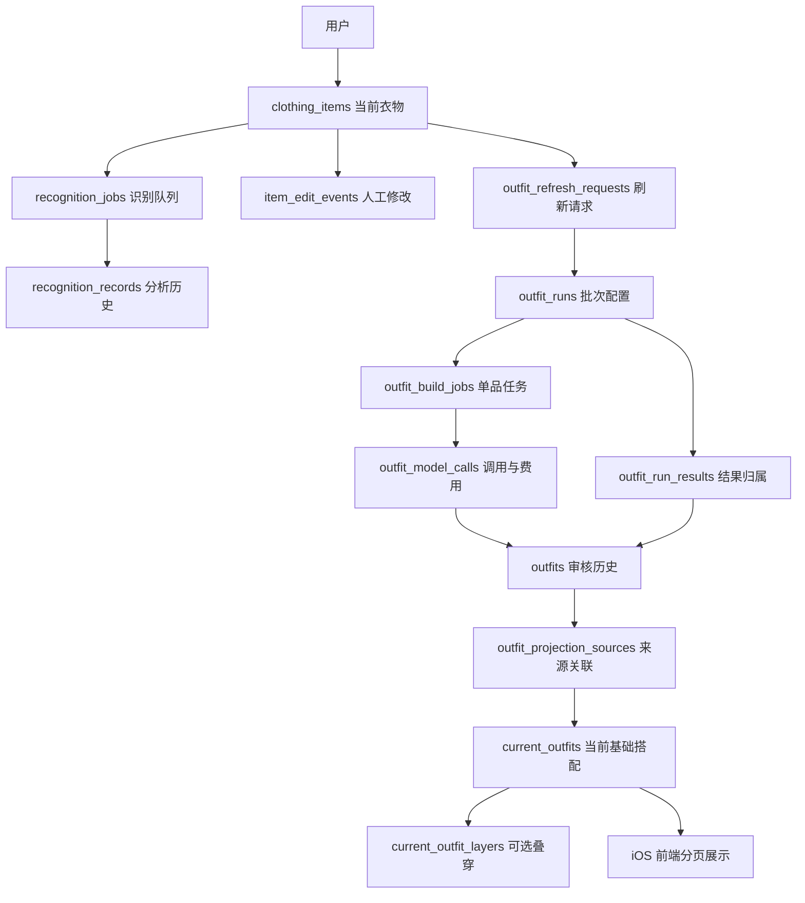

# AI Closet 数据架构与技术说明

更新日期：2026-10-09。

面向仓库读者和面试的介绍见[数据库设计介绍](DATABASE_GUIDE.zh-CN.md)与[后端架构介绍](BACKEND_GUIDE.zh-CN.md)。本文保留更详细的数据表、运行和迁移说明。

本文对应代码与迁移 008、009。迁移已在独立本地 PostgreSQL 验证；本文不代表线上 Supabase 已执行迁移。上线步骤见最后一节。

## 1. 设计目标

系统需要同时支持三个用途：用户管理衣柜、后台生成搭配、研究比较不同算法。数据结构应保证：

- 用户已确认的衣物标签不会被较晚返回的模型结果覆盖。
- 模型或 worker 中断后，任务可以重试，已保存的结果可以复用。
- 前端查询当前搭配时，使用可直接筛选、分页的数据。
- 历史识别、人工修改、模型审核与实验配置可以追溯。
- 模型费用按实际调用记录，不能因为一次调用产生多套搭配而重复计算。

“当前有效”“历史结果”“一次生成批次”“一次模型调用”分别建模。它们的数量通常不同。

## 2. 技术选型

| 技术 | 承担职责 | 选用原因与边界 |
|---|---|---|
| Supabase PostgreSQL | 线上主数据库 | 衣物、用户、搭配存在明确关联；事务、外键、唯一约束与索引可以共同保证一致性 |
| PostgreSQL JSONB | prompt 配置快照、模型详细输出、修改前后值 | 模型字段持续演进，适合保留完整结构；高频查询状态另外提供明确字段 |
| pgvector | 衣物语义向量与特征向量 | 与衣物和用户权限一起管理；当前候选排序仍包含应用层计算，不意味着所有检索都已变成数据库近邻查询 |
| Supabase Storage | 图片文件 | 数据库保存图片路径；API 按需要生成临时访问地址，避免把文件字节重复存进每张表 |
| Supabase Auth + RLS | 身份与用户隔离 | 数据按 `user_id` 归属；客户端只能读取授权数据，队列与模型写入由后端控制 |
| Python / FastAPI | 业务 API、校验、前端返回 | 将用户编辑、识别、搭配和数据导出连接起来 |
| 独立 worker + PostgreSQL 任务表 | 耗时模型调用、重试与恢复 | 模型调用不阻塞用户请求；任务状态持久化，支持多个 worker 领取工作 |
| SQL RPC | 多表原子提交、投影发布、批次入队 | 把必须共同成功的数据库操作放进同一事务，而非多次独立 HTTP 写入 |
| SQLite / JSON 文件 | 本地开发与测试适配器 | 便于离线测试；生产的一致性保证以 PostgreSQL 路径为准，JSON 文件适配器不具备跨文件崩溃原子性 |

当前 `feature_vector` 为 13 维类别/风格特征，`semantic_vector` 为 1536 维语义表示。标签用于解释与编辑，向量用于计算，它们不是互相替代的字段。

## 3. 数据结构

### 3.1 用户与衣物

| 表 | 保存的内容 | 一条记录的含义 |
|---|---|---|
| `user_preferences` | 用户资料、偏好和设置 | 一个用户的当前偏好 |
| `clothing_items` | 当前标签、图片路径、材质、衣长、袖长、向量、识别状态 | 一件衣物的当前状态 |
| `recognition_records` | 分析结果、模型/版本、归一化内容、原始信息 | 一次识别或人工修正产生的分析记录 |
| `item_edit_events` | 修改字段、修改前后内容、操作来源 | 一次人工修改事件 |
| `item_feature_snapshots` | 特征版本、向量和额外特征 | 某个时点的特征快照 |
| `recognition_jobs` | 排队、处理、重试、失败信息 | 一次衣物识别任务 |

`clothing_items` 用于产品当前状态，其他记录用于解释“这个状态是如何形成的”。人工反馈有独立记录，可以作为后续个性化算法的数据。

### 3.2 搭配当前状态与审核历史

| 表 / 视图 | 职责 |
|---|---|
| `outfits` | 版本化搭配审核历史；保留详细输出和参与衣物的版本信息 |
| `outfit_items` | 审核搭配与衣物的多对多关系 |
| `current_outfits` | 前端当前有效的基础搭配，一套基础组合对应稳定 ID |
| `current_outfit_layers` | 基础搭配的可选叠穿方案 |
| `outfit_projection_sources` | 当前基础搭配依赖哪些历史审核记录 |
| `outfit_evaluation_index` | 便于查询的审核索引视图，包含 `is_current` |
| `outfit_refresh_requests` | 当前数据版本与已发布版本；也是持久化的刷新请求 |
| `outfit_build_jobs` | 以单品为起点的生成任务，包含租约、重试、状态和批次 ID |
| `outfit_libraries` | 旧版启用登记，保留兼容；Supabase worker 已从刷新请求发现需要处理的用户 |

例如“白衬衫＋黑裙子”是一个基础搭配。“再加一件外套”保存在可选叠穿表。换模型重审会增加审核历史，前端基础搭配不会因此重复计数。

`is_current` 的定义是“此审核记录正在支撑当前发布的搭配”。它不等于“最新时间戳”，也不等于“模型给出了通过”。这个值从关联关系计算，不额外维护一个独立布尔字段。

### 3.3 生成批次与模型用量（009 新增）

| 表 / 视图 | 职责 |
|---|---|
| `outfit_runs` | 一次批次的算法、生成/复核模型、prompt 哈希、完整配置快照、创建时间、实验保留标记 |
| `outfit_model_calls` | 一次模型调用的阶段、任务、尝试次数、用量、耗时、费用估算与调用状态 |
| `outfit_run_results` | 批次与生成/复用的审核结果之间的关系 |
| `outfit_run_summary` | 数据库汇总视图：任务进度、调用数、token、已知费用、未知费用次数、去重结果数 |
| `data_retention_policies` | 每类数据的保留方式与期限 |
| `history_maintenance_runs` | 历史维护操作的预览/执行记录 |

一次同步发现若干新任务，会建立一个批次并原子入队。再次点击而没有新任务，不会制造一个空批次。原有任务重试仍归属于原批次；若要做独立实验，应使用独立实验配置/工作流，而非把重试当作新实验。

批次配置冻结后不可直接修改。`pinned` 和保留理由可以调整。每个新结果引用批次和调用 ID，避免重复保存完整 prompt、配置与生成用量。

旧审核记录不自动补上虚构的批次或费用。没有可靠来源的历史数据继续标记为未知；旧导出器仍可通过批次关联读取配置。



## 4. 为什么单独记录批次与调用

假设一次生成请求输出 8 套候选，然后逐套复核：

- 生成调用记 1 次。
- 实际发出的复核请求分别记账；命中已有审核缓存时，不新增复核调用。
- 同一套搭配被多个单品任务发现，仍可复用同一份审核结果。
- 即使两次并发请求最终得到同一个结果，两个真实发出的请求都需要保留费用记录。
- 生成失败、超时和 worker 中断会保留调用状态；没有收到可靠用量时，费用保持未知。

因此，“搭配数 × 单次费用”不是正确的费用算法。报表直接汇总调用账本，并将未知部分单独列出。

费用为 USD **估算**：使用批次冻结的价格快照，区分普通输入、缓存输入、输出 token。未配置价格或用量不完整时，`estimated_cost_usd` 为空。`known_estimated_cost_usd` 仅表示已知部分，最终应与服务商账单核对。系统不内置可能过时的模型价格。

完整费用总额只有在该批次所有调用都有可计算费用时才非空。失败调用也可能已被服务商计费，不能自动写成 0。

## 5. 为什么把状态提取成字段

`outfits` 增加数据库生成字段：

- `core_review_status`：基础搭配的审核状态。
- `full_review_status`：包括可选层后的完整搭配状态。
- `optional_layer_verdict`：可选叠穿是否明确改善效果。
- `run_id`：批次关联。

这些状态从 JSON 审核内容计算，避免手工双写造成“JSON 是 fail，列却是 passed”。旧版只有数字评分的记录标记为 `unreviewed`，不擅自转换成新版视觉审核通过。

当前搭配表也有 `review_status`，并对用户、状态、稳定 ID、批次、调用阶段等建立索引。详细理由和模型输出保留 JSON，以便继续扩展审核规则。

前端普通查询只读取当前搭配，数据库完成筛选、总数统计与分页；图片只为当前页面签名。背景刷新仍会读取审核历史构建当前结果，因此这一步的成本并未消失，而是从每个用户请求移到了版本变化后的后台处理。

## 6. 写入一致性与故障处理

### 衣物上传和修改

008 提供 SQL RPC，将新衣物与识别任务一起创建；将衣物更新、相关分析/修改/特征记录以及识别完成状态作为同一提交单元。提交时检查衣物快照，较旧的结果不能覆盖后来的用户修改。

衣物数据变化通过数据库触发器立即撤下受影响的当前搭配，并递增刷新版本。这是一个按用户合并的持久化刷新请求：短时间多次修改可以合并处理。

### 模型调用和 worker

模型网络调用在数据库事务外执行。任务通过租约领取；写入搭配审核时再次检查租约和衣物版本。结果使用唯一键去重，任务可复用已提交审核。

调用账本先登记 `running`，请求结束后填写用量。worker 消失时，恢复逻辑将失去有效任务租约的调用标为 `unknown`。这能显示哪些费用不完整，但不能阻止服务商在客户端超时后继续完成和收费。

### 发布当前搭配

后台先根据历史审核构建基础搭配与可选层，再以当前刷新版本做条件发布。构建过程中衣物再次变化，发布会被拒绝，下一次刷新重建。删除旧投影、写入新投影及来源关联属于同一数据库事务。

数据库事务保证的是数据库内部的一致性。图片对象存储、模型服务和前端刷新不在同一事务内；网络超时、外部账单和 UI 更新仍需要重试与状态查询。不要将这套机制解释成整个系统端到端“恰好执行一次”。

## 7. 历史保留策略

| 数据 | 默认策略 | 原因 |
|---|---|---|
| 衣物当前状态、当前搭配 | 随业务更新 | 产品展示的当前数据 |
| prompt / 配置批次、调用 token 与费用计数 | 保留 | 实验追溯和费用统计 |
| 已结束调用的原始 `raw_usage` JSON | 180 天后可压缩，默认仅预览 | 类型化计数已保留，原始用量结构不必无限重复存储 |
| 完整搭配审核、识别历史 | 保留，不自动删除 | 人工评估、算法比较、回溯需要证据 |
| 用户人工修改事件 | 保留，不自动删除 | 是个性化学习与用户意图的重要数据 |
| 特征快照 | 保留，暂不自动删除 | 删除前应确认历史数据集与评估依赖 |
| `pinned` 实验批次 | 跳过压缩 | 保护教授展示和方法比较数据 |

压缩功能只清空满足期限、未受保护且任务已结束的调用 `raw_usage`，保留 token、费用、模型、批次和调用身份；不会删除衣物、搭配或人工标注。`--apply` 才执行，数据库再次检查条件并记录操作。当前没有自动定时清理任务。

这个版本重点减少**新数据的重复存储**，没有为追求空间而删除历史。完整模型输出未来若要归档到对象存储，应另外提供归档清单、校验和和恢复工具，再定义删除期限。

## 8. 运行与上线

先停止 API 和两个 worker，避免新旧数据库协议混用。按顺序在 Supabase SQL Editor 执行：

1. `backend/sql/migrations/008_atomic_items_and_current_outfits.sql`（尚未执行时）。
2. `backend/sql/migrations/009_outfit_runs_and_retention.sql`。

不要用整份 `schema.sql` 作为线上升级脚本；它用于新环境初始化。

在项目的 `backend` 目录运行：

```bash
# 从已保存的审核记录建立当前展示表，不调用模型、不新建生成任务。
/opt/anaconda3/bin/python -m app.refresh_outfit_projection --all-users

# 查看指定用户的批次进度与费用。将 YOUR_USER_ID 换成实际 ID。
/opt/anaconda3/bin/python -m app.outfit_runs --user-id YOUR_USER_ID

# 保护某次实验。
/opt/anaconda3/bin/python -m app.outfit_runs --user-id YOUR_USER_ID --pin RUN_ID --reason "Professor comparison"

# 预览原始用量压缩，不修改调用内容。
/opt/anaconda3/bin/python -m app.outfit_runs --user-id YOUR_USER_ID --compact-usage

# 确认预览结果后执行；每次处理最多 1000 条。
/opt/anaconda3/bin/python -m app.outfit_runs --user-id YOUR_USER_ID --compact-usage --apply
```

随后分别启动 API、识别 worker、搭配 worker。正常搭配 worker 会继续扫描衣物并生成缺少的搭配，因此它与“不调用模型的投影重建”是不同操作。

本次不需要 iOS 展示字段变化。新批次统计通过数据库视图与 CLI 查看。

## 9. 验证与限制

- Python 测试覆盖重复入队、跨任务复用审核、按调用计费、缓存输入价格计算、未知费用、崩溃状态恢复、预览与实验保护。
- SQL 集成断言覆盖 008 的事务回滚/版本校验/分页，以及 009 的配置冻结、类型化审核状态、当前来源关联和保留策略。
- 本地 PostgreSQL 没有安装 pgvector，SQL 集成测试把原有向量列用 text 替代；本次迁移不修改向量运算。线上 pgvector 与 Supabase 权限环境仍应在部署后做一次冒烟检查。
- 本地 JSON 衣物仓库与 PostgreSQL 生产路径的事务能力不同；生产可靠性以 SQL RPC 路径为准。
- 冻结 prompt 和模型配置便于比较配置，不保证能逐字重现模型输出。照片修改后的原始文件保留与完整输入归档是另一项生命周期设计。
- 当前没有自动补算历史调用费用，也没有自动删除任何实验或人工标注数据。

## 10. 对应实现

- `backend/app/outfits/runs.py`：批次定义、调用计时和费用估算。
- `backend/app/outfits/run_store.py`：批次、调用、结果关联与维护持久化。
- `backend/app/outfits/service.py`：生成接入、审核复用、当前投影构建与来源关联。
- `backend/app/outfit_runs.py`：批次查询、实验保护、压缩预览 CLI。
- `backend/app/refresh_outfit_projection.py`：无模型调用的当前展示数据重建。
- `backend/sql/migrations/008_atomic_items_and_current_outfits.sql`：原子提交与当前展示模型。
- `backend/sql/migrations/009_outfit_runs_and_retention.sql`：批次、计费、状态索引与保留策略。
