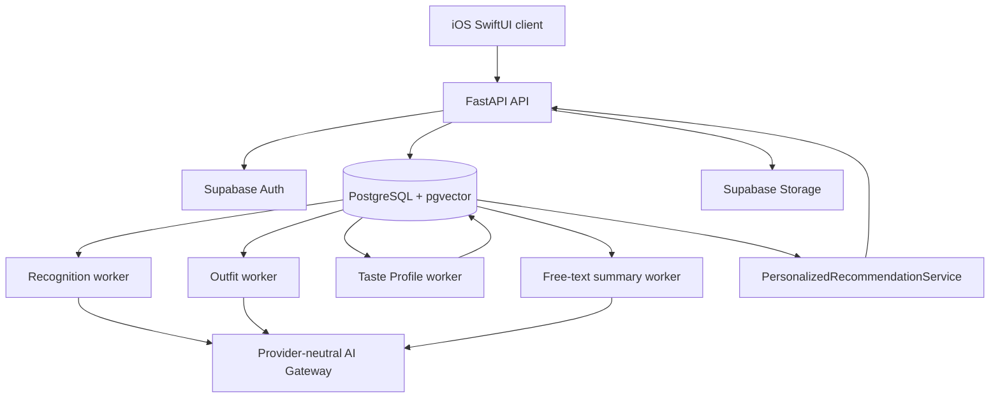

# System architecture

AI Closet is an iOS application backed by a FastAPI modular monolith, Supabase
PostgreSQL/Auth/Storage, and four independently deployable workers. The backend
owns taxonomy, authorization, persistence, AI orchestration, outfit generation,
personalization, and recommendation ranking.

## Runtime topology

The API and workers run from one codebase but scale independently. Durable jobs,
leases, retry limits, version checks, and stale-result rejection keep model calls
outside synchronous HTTP requests.

## Upload and recognition

1. iOS uploads an image through the authenticated API.
2. The backend stores the object under a user-scoped path, creates the garment
   card, and enqueues a recognition job.
3. The recognition worker reads the user's latest taxonomy, calls the configured
   AI Gateway, normalizes the response, and computes semantic and feature vectors.
4. A version check prevents an older job from overwriting a newer user edit,
   replacement image, or deleted item.
5. Current labels are stored on `clothing_items`; model evidence and feature
   snapshots remain separately auditable.

Opening and closing an item card confirms the displayed labels. Confirmed fields
remain protected from later model results. Replacing an image creates a new
recognition revision while retaining the item identity.

## Taxonomy ownership

The backend is the only default taxonomy source. `GET /api/v1/taxonomy` returns
the effective per-user catalog, including categories, subtypes, colors, seasons,
styles, occasions, lengths, and materials. iOS caches that response for display
and editing but does not maintain a competing built-in catalog.

## Outfit generation

The outfit worker processes eligible anchor garments; Bags, Shoes, and
Accessories are excluded from automatic anchor enrollment but remain available
as candidates and can be generated manually.

The active pipeline is:

1. Select a bounded, role-balanced catalog using saved labels and vectors.
2. Generate clothing combinations with hard category, season, purpose, and
   layering constraints.
3. Select shoes and optional accessories together for each retained clothing set.
4. Perform one final whole-outfit visual review.
5. Publish only current, structurally valid results; retain rejected evidence and
   usage diagnostics for audit.

Shoes are required for an admitted generated outfit. Optional outerwear and
accessories must satisfy their higher admission threshold. Historical numerical
scores remain audit data and are not executable admission policy.

Every run records a versioned runtime snapshot covering taxonomy, prompts,
models, provider, Taste parameters, and deterministic rules. A changed item or
configuration creates a new revision instead of silently mutating old evidence.

## Recommendations and Today

Today and Recommendations both call `PersonalizedRecommendationService`. They
may start with different weather, occasion, and request-source context, but use
the same eligibility, scoring, recent-wear, Taste Profile, and exploration logic.
Neither endpoint builds a second private recommendation algorithm.

Ranking order is:

1. enforce ownership, current-item, exact-dislike, hard compatibility, and
   48-hour recent-wear exclusions;
2. score weather, occasion, style, color, completeness, and semantic fit;
3. apply bounded per-user Taste weights and free-text summary evidence;
4. apply the post-exclusion wear-decay penalty;
5. reserve the configured deterministic exploration share and diversify results.

A daily selection is persistent. Regeneration produces candidates without
silently replacing the selected Today outfit.

## Feedback and personalization

Like, Wear It Today, personal outfit saves, and reason-scoped Not for Me actions
are stored as immutable user-scoped evidence. The Taste Profile worker replays
that evidence through a deterministic reducer and publishes with compare-and-set
`source_version` protection. The recommendation ranker and outfit generation
prompt read the resulting profile. Hard wearability rules always take precedence.

Reasonless dislikes immediately hide the exact composition. They may accumulate
in a private latent cluster but do not directly change feature weights. Free-text
feedback is stored first and summarized only after the configured batch threshold.
Cross-user learning and automatic regeneration of old outfits are disabled.

See [Taste learning](../product/taste-learning-pipeline.md) and
[personal outfits and wear](../product/personal-outfits-and-wear.md).

## AI provider boundary

Recognition, embeddings, outfit generation, visual review, agent planning, and
free-text summarization use `app.ai.gateway.AIGateway`. The default adapter speaks
OpenAI-compatible Responses and Embeddings APIs. Provider URL, credentials, and
model names are configuration; domain services do not construct provider clients.

## Data and security

Supabase Auth establishes user identity. Repositories scope reads and writes by
`user_id`, while RLS provides the database boundary. Images use stable private
storage paths and short-lived signed URLs. Service-role credentials and AI keys
exist only in backend processes.

See [database design](database.md) and the ordered migrations in
[`backend/sql/migrations/`](../../backend/sql/migrations/).

## Operations

The API exposes liveness, readiness with configuration hash, queue health, and a
protected metrics endpoint. Structured JSON logs include request ID, service,
latency, status, and safe exception type. Production topology and required
secrets are defined in `render.yaml`.

See [local development](../operations/local-development.md),
[deployment](../operations/deployment.md), and the generated
[OpenAPI contract](../api/openapi.json).
