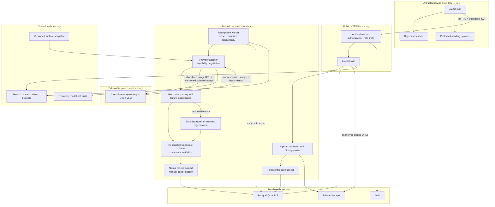

# AI Closet Production Architecture and Reliable Cloud VLM Roadmap

Status: active — Phases 0–1 complete; Phase 2 approved and in progress
Created: 2026-11-04
Scope: recognition reliability, cloud VLM integration, upload security,
asynchronous inference, iOS production integration, observability, deployment,
and App Store readiness.

This is an implementation plan, not authorization to execute every phase. Each
phase requires explicit approval, is implemented and validated independently,
and ends before work begins on the next phase.

The plan preserves the current recommendation, Taste Profile, durable queue,
Supabase, and SwiftUI architecture wherever those components already satisfy the
requirements.

## 1. Executive summary

AI Closet already has a substantial production-oriented foundation:

- SwiftUI iOS client with multi-image selection and recoverable pending uploads.
- FastAPI backend with Supabase Auth, PostgreSQL, private Storage, and RLS.
- Persistent recognition and outfit queues with leases, retry limits, dead-letter
  state, crash recovery, and stale-write protection.
- Atomic recognition commits that protect manual edits and newer item revisions.
- Backend-owned user taxonomy, recommendation rules, Preference, Taste Profile,
  and feedback processing.
- A provider-neutral `AIGateway` protocol, versioned runtime snapshots, Render
  deployment configuration, CI, and automated tests.

The most urgent defect is that production recognition does not actually pass a
schema to the AI gateway. The gateway can construct a JSON Schema request, but
`ClothingRecognitionService` currently requests free-form text, strips optional
Markdown fences, calls `json.loads`, normalizes permissively, and then constructs
the persistence model. Prompting the model to return JSON is therefore not the
same as constrained output.

The safest sequence is:

1. Separate strict provider output from the persisted garment domain model.
2. Add provider capability declarations and real schema-constrained output where
   the selected multimodal endpoint supports it.
3. Add bounded repair, failure classification, retry budgets, and model-call
   auditing while retaining the current durable queue and atomic commit path.
4. Compare cloud-hosted open-weight VLMs on a frozen, human-labeled dataset before
   changing the production model.
5. Harden uploads, sessions, quotas, logging, deployment, account deletion, and
   App Store privacy workflows incrementally.

Large VLMs must not be downloaded or run on the 16 GB development Mac. Existing
local smoke-test artifacts remain historical evidence only; future large-model
evaluation should use approved, budget-limited cloud inference.

## 2. Verified repository findings

| Subsystem | Current implementation | Key paths | Assessment |
|---|---|---|---|
| iOS client | SwiftUI, `APIClient`, ViewModels, PhotosPicker, item editing | `ios/AI Closet/ClosetHomeView.swift`, `ios/AI Closet/API/APIClient.swift`, `ios/AI Closet/ViewModels/ClosetViewModel+Uploads.swift` | Reuse; no new client framework needed |
| Pending uploads | Protected files in Application Support, batch upload and partial-failure reconciliation | `ios/AI Closet/ViewModels/ClosetViewModel+Uploads.swift` | Strong base; add size limits, progress, and logout cleanup |
| Authentication | Supabase session in iOS; backend verifies bearer token with Supabase | `ios/AI Closet/Auth/AuthStore.swift`, `backend/app/services/auth_service.py` | Backend flow is usable; move refresh tokens from `UserDefaults` to Keychain |
| Storage | Private Supabase bucket, user-scoped paths, signed URLs | `backend/app/services/storage_service.py`, `backend/sql/migrations/002_user_isolation_rls.sql` | Reuse; add upload content and size validation |
| Recognition queue | Persistent jobs, attempts, leases, timeouts, terminal failure | `backend/sql/migrations/003_recognition_queue.sql`, `backend/workers/recognition.py` | Reuse; no Celery/Redis replacement required |
| Atomic recognition | Lease/item revision checks and atomic result persistence | `backend/sql/migrations/008_atomic_items_and_current_outfits.sql`, `backend/app/services/recognition_pipeline.py` | Strong stale-write and manual-edit protection |
| AI gateway | Protocol plus OpenAI Responses/Embeddings transport | `backend/app/ai/gateway.py` | Reuse but add capability-aware provider adapters |
| Recognition output | Free-form response parsed with `json.loads`, then normalized | `backend/app/services/recognition_service.py` | Primary reliability gap; schema is not passed to the gateway |
| Domain schema | `ClothingAnalysis` combines model, derived, audit, and persistence fields | `backend/app/models/domain.py` | Do not use directly as provider output schema |
| Semantic checks | Strict `ColorTone` and `WearingProfile` models and contradiction checks | `backend/app/models/domain.py` | Extract and reuse in the canonical inference pipeline |
| Taxonomy | Backend and per-user taxonomy drive the current main flow | `backend/app/services/taxonomy.py` | Keep backend as source of truth; remove confirmed legacy client duplication later |
| Legacy iOS recognition | Direct Gemini/local recognition code still compiles | `ios/AI Closet/ClothingRecognition/`, `ios/AI Closet/CategoryClosetView.swift` | Confirm unreachable, then remove or quarantine |
| Recommendation | Outfit workers, hard rules, Taste ranking, feedback and history | `backend/app/outfits/`, `backend/app/services/taste_profile.py` | Preserve; outside the schema-reliability rewrite |
| Observability | JSON logs, request IDs, worker logs, process-local counters | `backend/app/core/observability.py` | Add durable metrics, traces, cost and recovery data |
| Deployment | Render API plus four always-on workers | `render.yaml` | Deployable, but fixed early-stage cost can be reduced after profiling |
| CI | Backend test/lint/type subsets, migration/OpenAPI/docs checks, iOS build | `.github/workflows/ci.yml` | Add PostgreSQL integration, Swift tests, and security scanning |
| App Store | Bundle ID, automatic signing, location permission | `ios/AI Closet.xcodeproj/project.pbxproj` | Missing verified account deletion, production endpoint, and privacy artifacts |

Verified findings above come from repository inspection. Cloud-provider model
availability, retention terms, regional processing, and production secrets are
not inferable from the repository and must be verified before rollout.

## 3. Recommended production architecture



The iOS app never receives a provider key. Invalid model output may be retained
in a redacted audit record but cannot update the current garment projection. The
system does not promise exactly-once model execution; persistent leases,
idempotent effects, and fenced commits provide effectively-once result
persistence.

## 4. Gap analysis and priorities

| Gap | Required change | Priority | Risk if deferred |
|---|---|---:|---:|
| Production recognition is free-form JSON | Pass a strict runtime schema and validate before normalization | P0 | High |
| Persistence model is used as an implicit output contract | Add a dedicated, versioned `RecognitionCandidate` | P0 | High |
| Parser only strips Markdown fences | Classify truncation, syntax, schema, semantic, provider transient and provider permanent failures | P0 | High |
| No bounded repair path | Allow one deterministic syntax repair and at most one targeted regeneration | P0 | High |
| Qwen is shadow-only | Run approved cloud shadow evaluation before production switching | P0 | High |
| Gateway assumes one Responses API shape | Add capability-aware Responses/Chat Completions/provider adapters | P1 | Medium |
| Recognition calls lack cost/usage audit | Persist model, provider, latency, usage, repair and estimated cost | P1 | Medium |
| Uploads lack hard validation | Enforce bytes, MIME, magic bytes, dimensions and decompression limits before inference | P1 | High |
| Session token stored in `UserDefaults` | Move secret session material to Keychain | P1 | High |
| Debug logging exposes token prefixes and identifiers | Redact/remove sensitive client and backend logs | P1 | High |
| Claim RPC grants are not explicitly service-role-only | Revoke public/authenticated execution and grant service role | P1 | High |
| No user inference quotas | Add per-user concurrency/daily limits and global budget circuit breaker | P1 | High |
| Failure writes have weaker fencing than success writes | Require current lease/attempt ownership for failure transitions | P2 | Medium |
| Metrics are process-local | Add persistent/exported metrics, tracing and alerts | P2 | Medium |
| Readiness is mostly static | Separate liveness and dependency-aware readiness | P2 | Medium |
| Signed URL appears in recognition raw payload | Store object path/hash, not signed URL | P1 | Medium |
| Polling is the only completion mechanism | Retain initially; consider Realtime only after measured need | P3 | Low |
| Legacy Gemini/client taxonomy remains | Remove only after confirming no active call path | P2 | Medium |
| No verified account deletion workflow | Add in-app initiation and Auth/DB/Storage/local cleanup | Release P0 | High |
| No verified Privacy Manifest/AI disclosure | Add before TestFlight/App Store submission | Release P0 | High |
| iOS defaults to localhost endpoint | Add environment-specific HTTPS configuration | Release P0 | High |

## 5. Structured-output reliability design

### 5.1 Current behavior

Production currently follows:

```text
VLM free-form text
→ optional Markdown fence removal
→ json.loads
→ permissive normalization/defaults
→ ClothingAnalysis
→ atomic commit
```

`AIGateway.response` can accept a Pydantic model or JSON Schema and construct a
strict structured-output request. Recognition does not currently pass that
argument. This means valid JSON is requested through prompt instructions but not
enforced by the provider.

### 5.2 Existing empirical evidence

The frozen ten-item Qwen3-VL-4B local smoke-test artifacts recorded:

- 10/10 model calls completed.
- 9/10 responses parsed as JSON.
- 3/9 parsed responses passed the current production model.
- One response was truncated at the configured output-token limit.
- Four responses contained invalid `color_tones` structures.
- Two contained invalid `wearing_profile` fields, including a misspelled field
  and the string `"null"`.
- Some responses were structurally valid but visually wrong, including Hat to
  Bags and Tights to Activewear.

These results demonstrate failure modes only. They do not establish production
accuracy for Qwen3-VL-8B, Qwen2.5-VL-7B, or a cloud provider.

### 5.3 Canonical schema

Create a provider-output DTO separate from `ClothingAnalysis`:

- `extra="forbid"` at every level.
- Explicit required fields.
- JSON `null` for genuinely uncertain visual properties.
- Strict scalar `category` and `subtype`; provider-specific array coercion, if
  temporarily retained, belongs in an audited compatibility adapter rather than
  the canonical schema.
- Runtime validation against the user's latest taxonomy.
- Exact structure for color tones, occasion scores, and wearing profile.
- Cross-field semantic rules for wearing/layering contradictions.
- No internal source, database version, raw response, URL, or derived vector
  fields in model output.

Dynamic user enums should be represented by a runtime schema factory or by a
strict structural schema followed by runtime semantic enum validation, depending
on the selected provider's supported JSON Schema subset.

### 5.4 Bounded recovery

```text
Model response
  ├─ valid JSON + valid schema + valid semantics → normalize and commit
  ├─ formatting-only syntax error → one safe repair → full validation
  ├─ truncated response → one retry with adjusted output budget
  ├─ schema/semantic error → one targeted regeneration when justified
  ├─ timeout/429/5xx → bounded queue retry with jitter/Retry-After
  └─ auth/config/unsupported parameter → terminal; no paid retry loop
```

No `eval`, unrestricted replacement, infinite retry, or persistence before full
validation is permitted. A job may perform at most two image inferences by
default. Formatting repair should reuse text and avoid reprocessing the image.

### 5.5 Provider capabilities

Each adapter declares and is contract-tested for:

- multimodal image input;
- JSON mode;
- JSON Schema constrained output;
- grammar-constrained decoding;
- finish reason and truncation metadata;
- usage reporting;
- retry guidance;
- provider request/response IDs.

OpenAI compatibility alone is not evidence that a specific multimodal model
supports schema-constrained decoding. The exact provider/model/image/schema
combination must pass a probe before it becomes eligible for production.

## 6. Phased implementation roadmap

### Phase 0 — Repository audit and architecture plan

- **Objective:** Record the verified architecture, gaps, rollout sequence, and
  decisions without modifying runtime behavior.
- **Reuse:** Entire current repository.
- **Files changed:** Planning documentation only after the audit was accepted for
  documentation.
- **Tasks:** Review iOS, API, SQL, queues, AI gateway, schemas, security, CI,
  deployment, evaluation artifacts, and App Store gaps.
- **Dependencies:** None.
- **Acceptance:** This document and its decision gate are complete.
- **Validation:** Read-only source inspection; no live paid calls.
- **Risk:** Cloud settings and provider contractual terms are external to the repo.
- **Rollback:** Documentation-only change.

### Phase 1 — VLM schema reliability

- **Objective:** Guarantee that only structurally and semantically valid
  recognition data can become current item state.
- **Reuse:** `AIGateway`, recognition normalization, durable jobs, atomic commit,
  current taxonomy.
- **Expected files:** `backend/app/models/recognition_output.py` (new),
  `backend/app/services/recognition_service.py`,
  `backend/app/services/recognition_normalization.py`,
  `backend/app/ai/gateway.py`, recognition tests.
- **Tasks:** Add `RecognitionCandidateV1`, runtime taxonomy schema, strict parse
  and semantic validation, failure taxonomy, truncation detection, bounded repair,
  schema/prompt hashes, and feature flags.
- **Dependencies:** Decisions D1–D3 below.
- **Acceptance:** Every request ends valid or explicitly terminal; invalid output
  never persists; permanent errors do not retry; at most two image calls/job;
  first-pass schema-valid rate target >=95% and final rate >=99% on the approved
  provider contract set.
- **Tests:** Valid, invalid, missing, extra, enum, type, null, truncated, empty,
  Markdown, successful/failed repair, and exhaustion cases with mocked providers.
- **Risks:** Provider schema subsets and over-strict runtime enums.
- **Rollback:** Feature flag restores the existing parser; no destructive database
  migration is required in the first change.

### Phase 2 — Cloud VLM provider integration

- **Objective:** Evaluate and safely switch between approved hosted open-weight
  VLMs without changing business logic.
- **Reuse:** Gateway protocol, Shadow Harness, runtime snapshots, frozen baseline.
- **Expected files:** `backend/app/ai/gateway.py`, new
  `backend/app/ai/providers/`, `backend/app/core/config.py`,
  `backend/app/core/runtime_snapshot.py`, Shadow evaluation tools/tests.
- **Tasks:** Add Responses and Chat Completions adapters, capability negotiation,
  provider-specific authentication and errors, cloud shadow evaluation, and
  fail-closed model allowlists.
- **Dependencies:** D4–D7, provider account, explicit evaluation budget.
- **Acceptance:** Provider switching is configuration-only; frozen evaluation
  reports schema validity, attribute quality, latency and cost; production remains
  on the old model until the challenger passes the gate.
- **Tests:** Timeout, 429, 401/403, 5xx, unsupported parameter, successful image
  schema response, missing usage/finish reason, and provider switching.
- **Risks:** Advertised structured output may not support the target VLM with
  image input.
- **Rollback:** Restore provider/model environment variables and the existing
  baseline snapshot; existing recognition/outfit/taste records remain untouched.

### Phase 3 — Image upload and Storage security

- **Objective:** Reject unsafe or wasteful inputs before Storage/model inference.
- **Reuse:** Private bucket, user-scoped paths, signed URLs, pending uploads.
- **Expected files:** Upload/storage services and routes, iOS upload code, Storage
  policy/migration tests.
- **Tasks:** Byte limits, MIME/magic validation, dimension/pixel limits,
  decompression protection, standard image normalization, orphan reconciliation,
  and signed-URL redaction.
- **Dependencies:** D8 upload limits.
- **Acceptance:** Malformed, unsupported, oversized and cross-user requests are
  rejected before inference; partial batches remain recoverable.
- **Tests:** Wrong MIME, corrupt/truncated images, oversized dimensions, partial
  failure, duplicate upload, Storage failure and orphan cleanup.
- **Risks:** Legitimate HEIC/high-resolution photos may be rejected if limits are
  too tight.
- **Rollback:** Limits are versioned/configurable; retain old thresholds during
  staged rollout.

### Phase 4 — Asynchronous inference pipeline

- **Objective:** Make retries provider-aware, budgeted, idempotent and observable.
- **Reuse:** PostgreSQL jobs, `SKIP LOCKED`, leases, timeouts, atomic fenced commit.
- **Expected files:** Queue SQL, repository, recognition pipeline/worker and tests.
- **Tasks:** Failure-class-specific retry, exponential backoff with jitter and
  `Retry-After`, fenced failure transitions, explicit idempotency keys, per-user
  concurrency/daily quotas, terminal failure API and cost guardrails.
- **Dependencies:** Phase 1 failure taxonomy and D9 quotas.
- **Acceptance:** Worker crash recovery; stale jobs cannot write; duplicates yield
  one effective result; permanent errors consume no repeated paid calls.
- **Tests:** Concurrent claims, crash/lease expiry, duplicate jobs, stale success
  and failure, item edit/delete, retry recovery and exhaustion.
- **Risks:** Rolling deployment with old and new workers.
- **Rollback:** Expand/contract SQL migration and backward-compatible fields; roll
  workers back before contract cleanup.

### Phase 5 — SwiftUI production integration

- **Objective:** Expose a secure and recoverable end-to-end recognition workflow.
- **Reuse:** `APIClient`, ViewModels, PhotosPicker, pending queue, current item card
  and polling.
- **Expected files:** iOS API/Auth/ViewModel/item-card configuration files.
- **Tasks:** Keychain sessions, sensitive-log removal, upload progress, terminal
  failure/retry UI, cancellation/stale-response handling, build-configured HTTPS
  endpoint, and confirmed legacy Gemini removal.
- **Dependencies:** Stable Phase 1/4 API contract.
- **Acceptance:** Upload, app restart, network loss, token refresh and partial
  failures recover correctly; invalid attributes never appear as successful.
- **Tests:** XCTest and mocked API flows plus release-build smoke tests.
- **Risks:** Session migration may require one re-login.
- **Rollback:** One-time read migration from old storage and feature-flagged UI.

### Phase 6 — Production security and observability

- **Objective:** Add enforceable isolation, quotas, SLOs, audit and cost controls.
- **Reuse:** RLS, request IDs, JSON logging, runtime snapshots.
- **Expected files:** Middleware, gateway, workers, observability, SQL audit tables,
  CI security checks and operational docs.
- **Tasks:** Persistent metrics/traces, redacted model-call audit, schema rates,
  latency/token/cost/recovery metrics, user/IP limits, service-role RPC grants,
  secret scanning, dependency-aware readiness, alerts and budget circuit breaker.
- **Dependencies:** Monitoring destination and budget decisions.
- **Acceptance:** Operators can query first/final schema rates, P50/P95 and
  cost/success; budget exhaustion blocks new inference safely; no private image,
  signed URL or token appears in logs.
- **Tests:** Log redaction, quota boundaries, dependency failure, metric
  correctness and cross-user negative tests.
- **Risks:** High-cardinality/private metric labels.
- **Rollback:** Telemetry exporters can be disabled without disabling core work.

### Phase 7 — Cloud deployment

- **Objective:** Produce repeatable staging/production deployments and rollback.
- **Reuse:** `render.yaml`, locked dependencies, migration documentation.
- **Expected files:** Render/alternative platform config, optional Dockerfile,
  deployment workflow, runbooks.
- **Tasks:** Environment separation, immutable release/config snapshot, controlled
  migrations, worker rollout order, smoke tests, secret rotation, rollback drill,
  and measured worker consolidation.
- **Dependencies:** D10 hosting choice and D11 production budget.
- **Acceptance:** Staging verification gates production; migration failures stop
  rollout; the previous tagged release can be restored without data loss.
- **Tests:** Deploy smoke, health/readiness, one queued recognition and rollback.
- **Risks:** Mixed worker/schema versions during rollout.
- **Rollback:** Backward-compatible migrations and previous-image/tag redeploy.

### Phase 8 — App Store readiness

- **Objective:** Prepare the actual application and data flow for TestFlight and
  App Review rather than treating compilation as compliance.
- **Reuse:** Bundle ID, automatic signing and location permission.
- **Expected files:** Project/release settings, `PrivacyInfo.xcprivacy`, account
  settings UI, backend deletion workflow, privacy/release documentation.
- **Tasks:** In-app account deletion, Auth/DB/Storage/local deletion, Privacy
  Manifest and Privacy Policy, third-party AI disclosure/consent, ATS/HTTPS,
  release configuration, App Privacy answers and TestFlight checklist.
- **Dependencies:** D5 retention policy and D12 business model.
- **Acceptance:** A user can initiate full account deletion; release builds use a
  production HTTPS endpoint; deletion and privacy disclosures are verified on a
  real device/TestFlight.
- **Tests:** Deletion integration, clean install, upgrade, release archive,
  permissions and privacy-link validation.
- **Risks:** Incomplete deletion of Storage, Auth, or historical records.
- **Rollback:** Validate deletion against staging/dry-run manifests before enabling
  it in production; deletion itself cannot be treated as reversible.

### Phase 9 — End-to-end validation

- **Objective:** Establish evidence for reliability, security, regression,
  performance and release quality.
- **Reuse:** Existing automated tests, Shadow Harness, human annotations and
  baseline snapshot.
- **Expected files:** Versioned evaluation manifests/results, load/security tests,
  release checklist and public-safe summary.
- **Tasks:** Frozen-dataset comparison, regression, chaos, load and security tests,
  provider outage/rollback drill, human review and release sign-off.
- **Dependencies:** Phases 1–8.
- **Acceptance:** All gates in section 8 pass; no P0/P1 security issues; every
  public claim references a reproducible artifact.
- **Tests:** Full matrix below.
- **Risks:** Offline evaluation cannot prove real-user satisfaction.
- **Rollback:** Keep the challenger in shadow mode and retain the current provider
  when any gate fails.

## 7. Deployment and cost plan

All values are planning estimates and must be rechecked at deployment time.

| Option | Approximate early-stage baseline | Assessment |
|---|---:|---|
| Current Render: API + four Starter workers | About $35/month | Lowest migration risk, but five always-on services are expensive for low traffic |
| Render with measured consolidation: API + two worker services | About $21/month | Recommended only after proving combined workers do not create unacceptable failure coupling |
| Railway | $5 Hobby or $20 Pro minimum, then CPU/RAM/egress usage | Useful comparison; actual always-on worker memory determines cost |
| Dedicated always-on GPU | Provider/GPU hourly price | Not recommended initially; unnecessary operational and fixed-cost burden |
| Serverless/pay-per-request VLM | Per request/token | Recommended initial model-serving mode |

Supabase production should be budgeted separately. The current Pro plan begins at
approximately $25/month and includes one Micro compute credit plus production
storage/egress allowances. Current Render services plus Supabase Pro therefore
produce an estimated fixed baseline near $60/month before inference, monitoring,
domains, or overage.

Cloud candidate notes as of the audit date:

- Qwen3-VL-8B-Instruct is an Apache-2.0 open-weight candidate and can be served
  with vLLM/SGLang, but exact managed-provider availability must be checked.
- Qwen2.5-VL-7B-Instruct is the stable comparison candidate.
- DeepInfra's public catalog listed Qwen3-VL-30B-A3B at $0.15/M input and
  $0.60/M output tokens, but did not establish availability of the requested 8B
  model.
- Hugging Face Inference Providers can route multiple providers without an HF
  markup, but model- and provider-specific multimodal structured output still
  requires a contract probe.

Example only: at 3,200 input-equivalent tokens and 500 output tokens using the
above 30B public rate, one call is approximately $0.00078 and 1,000 calls about
$0.78 before retry/repair. Actual image token accounting must come from provider
usage metadata.

Cost controls required before production switching:

- per-user daily quota and concurrent-job cap;
- no more than two image inferences per job by default;
- text-only repair before a second visual call;
- 80% and 95% budget alerts;
- hard monthly circuit breaker;
- provider/model/pricing in the runtime snapshot;
- cost per successful recognition, not only cost per API response.

## 8. Evaluation and testing strategy

### 8.1 Frozen dataset

Use at least 100–200 versioned examples spanning single items, multiple items,
poor lighting, complex backgrounds, occlusion, ambiguous color/material,
custom/rare categories, non-clothing images, and unsupported inputs. Store an
image hash/object reference, annotation version, taxonomy/schema/prompt version,
and labels that distinguish unknown from missing.

### 8.2 Metrics and initial gates

| Metric | Definition | Initial gate |
|---|---|---:|
| First-pass schema-valid rate | Initial response passes strict structure and semantics | >=95% on a constrained-output provider |
| Final schema-valid rate | Valid after bounded recovery | >=99% |
| Terminal failure rate | No valid result after bounded recovery | <=1%, excluding deliberate unsupported/non-clothing cases |
| Recovery rate | Initially invalid responses recovered | >=80% |
| Category accuracy | Match with human ground truth | No regression from a newly frozen production baseline |
| Subtype accuracy | Match on human-judged eligible samples | No regression; target >=3 percentage-point gain |
| Macro F1 | Category/subtype quality under imbalance | Report with accuracy |
| Unknown precision | Unknown/null is genuinely visually uncertain | Report separately |
| Hallucinated-material rate | Confident material when not visually supportable | <=5% |
| P50/P95 latency | Upload completion to terminal recognition state | Set final SLO after cloud shadow data |
| Cost per success | Inference plus repair divided by successful recognitions | Within approved budget |
| Duplicate effective writes | Same item revision committed more than once | 0 |
| Cross-user access success | Negative authorization tests | 0 |

The previously reported 92% category accuracy remains a user-reported historical
result until its frozen dataset, annotation version, model/config version and
reproduction command are linked. It may be used as contextual evidence, not as a
new-model gate without provenance.

### 8.3 Required tests

**Structured output**

- valid and invalid JSON;
- missing and unexpected fields;
- incorrect enum values and field types;
- explicit null versus string `"null"`;
- truncated, empty and Markdown-wrapped output;
- semantic contradictions;
- successful and failed repair;
- retry exhaustion.

**Cloud provider contracts**

- success, timeout, 429, 401/403, 5xx and provider outage;
- unsupported structured-output parameters;
- provider switching;
- missing usage/finish-reason metadata;
- multimodal JSON Schema capability probe.

**Persistent processing**

- duplicate jobs and deterministic result persistence;
- concurrent workers and `SKIP LOCKED`;
- worker crash and lease recovery;
- stale success/failure after item edit, image replacement or deletion;
- partial batch failure and retry exhaustion.

**Security**

- unauthenticated, expired and forged JWTs;
- cross-user item/job/image access;
- unauthorized queue RPC execution;
- request/image-size limits;
- secret, signed-URL and token log scanning.

**iOS/regression**

- Keychain migration and refresh;
- pending upload recovery and cancellation;
- terminal recognition retry UI;
- upload/edit/delete/manual-protection behavior;
- vector refresh, outfit generation, Taste learning, Today and Recommendation;
- release endpoint and release archive.

Ordinary CI uses mocked AI providers. Live cloud evaluation requires an explicit
approved budget and a separate evaluation job; it never runs on every pull
request.

## 9. Decision register

Only decisions that materially affect implementation are listed here. Recommended
defaults allow Phase 1 to proceed without prematurely committing to a cloud
provider.

| ID | Decision | Recommended default | Needed by | Status |
|---|---|---|---|---|
| D1 | Does one photo produce one primary garment or multiple items? | One primary garment; detect multiple items and return a structured warning | Phase 1 | Approved 2026-11-04 |
| D2 | How should visually uncertain fields be represented? | JSON `null`; reserve `Unknown` only for user-facing taxonomy fields that require a stored category | Phase 1 | Approved 2026-11-04 |
| D3 | Maximum visual inference attempts per recognition job | Two total: first call plus at most one targeted regeneration; formatting-only failures repair the original text and do not trigger another visual call | Phase 1 | Approved 2026-11-04 |
| D4 | Primary cloud-model comparison | Qwen3-VL-8B-Instruct vs Qwen2.5-VL-7B-Instruct; use Qwen3-VL-30B-A3B only as a hosted fallback/control | Phase 2 | Approved 2026-11-04 |
| D5 | Provider privacy requirement | No training on customer data, zero/minimal retention, approved region, signed URLs <=15 minutes | Phase 2/8 | Approved 2026-11-04 |
| D6 | Initial cloud evaluation sample/budget | 100 frozen recognition samples/model plus 10 paired frozen outfit scenarios/model; hard combined evaluation budget $10 unless a provider's minimum requires explicit reconsideration | Phase 2 | Approved 2026-11-04 |
| D7 | Production promotion rule | Challenger must meet schema gates, not regress frozen category/subtype quality or outfit hard-rule yield, and stay within the latency/cost budget | Phase 2 | Approved 2026-11-04 |
| D8 | Upload limits | 15 MB/image, 30 images/request server-side, normalize longest edge for model input while preserving original privately | Phase 3 | Open |
| D9 | Initial per-user quota | 30 recognition jobs/day and 3 concurrent queued/processing jobs; configuration-based | Phase 4 | Open |
| D10 | Initial hosting platform | Keep Render for the first production pass; reconsider consolidation only after measurement | Phase 7 | Open |
| D11 | Monthly infrastructure/inference budget | $100/month hard planning ceiling, with 80% and 95% alerts | Phase 6/7 | Open |
| D12 | Initial business model | Free beta with no paid digital features; defer StoreKit until monetization is defined | Phase 8 | Open |
| D13 | Account-deletion retention | Delete Auth, private images and user-linked product data; retain only legally required, de-identified operational/financial records | Phase 8 | Open |
| D14 | Initial service-level objective | P95 recognition completion <=60 seconds under normal provider operation | Phase 6/9 | Open |

## 10. Phase approval and execution rules

Before each approved phase:

1. Reinspect relevant files and external provider contracts.
2. State exact implementation scope and expected files.
3. Preserve current data and working behavior.
4. Make only the approved phase's changes.
5. Add/update deterministic tests.
6. Run relevant tests, static checks and diff review.
7. Report completed work, modified files, passed/failed/untested behavior, risks,
   rollback path, and the next requested approval.
8. Stop before the next phase.

No phase may download a large VLM to the development Mac, make unapproved paid
calls, expose secrets, run destructive migrations, replace working queues without
evidence, persist invalid output, retry indefinitely, or modify existing user
recognition/outfit/preference/taste records without a tested rollback path.

## 11. Phase 1 implementation record

Completed on 2026-11-04:

- Added a strict, provider-facing `RecognitionCandidateV1` separate from the
  persistence model.
- Added runtime schemas and semantic validation for each user's latest taxonomy.
- Required exactly one primary garment and preserved structured warnings for
  multiple items, non-clothing input, and poor visibility.
- Required JSON `null` for uncertain optional fields and rejected sentinel strings.
- Passed strict JSON Schema to the production Responses transport.
- Classified empty, truncated, syntax, schema, semantic, and targeted-retry
  failures.
- Limited formatting repair to wrapper removal/object extraction that does not
  alter values and does not call the vision model again.
- Enforced at most two visual calls across service and durable-job recovery.
- Versioned the new recognition output and prompt contract.
- Added structured-output, retry-budget, custom-taxonomy, transport and terminal
  failure tests.

Validation completed without a live model call: 337 backend tests passed; Ruff,
the CI type-check boundary, imports/compilation, migration ordering and Markdown
links passed. First-pass/final schema-valid rates, cloud latency, accuracy and
cost remain deliberately unmeasured until an approved Phase 2 cloud shadow run.

## 12. Phase 2 execution record

Approved on 2026-11-04. The experiment uses one 100-item frozen recognition
sample and one 10-scenario frozen outfit suite for GPT-4.1-mini,
Qwen3-VL-8B-Instruct and Qwen2.5-VL-7B-Instruct. Recognition uses the Phase 1
runtime taxonomy and strict local validator. Outfit generation uses the exact
same anchors, production-selected catalogs, prompt and policy snapshot for each
model; production hard rules are applied locally without saving any outfit.

The combined live-call budget is capped at $10. Signed image URLs expire after
15 minutes. Raw provider responses are retained only in the local evaluation
artifacts with signed URLs redacted. Existing recognition, outfit, preference
and Taste Profile records are never overwritten by the experiment.

Implementation is in progress. A paired 10-item Recognition pilot completed on
2026-11-04. GPT-4.1-mini produced 8/10 strict-schema-valid results at mean 8.38 s
and estimated cost $0.03369. Qwen3-VL-8B produced 9/10 valid results at mean
20.08 s and estimated cost $0.03874. The human-confirmed subset contained only
five valid outputs per model, so its apparent category accuracy (GPT 40%, Qwen3
60%) and subtype accuracy (GPT 20%, Qwen3 40%) are pilot diagnostics, not
promotion evidence. Qwen2.5-VL-7B produced one repaired result, then nine
consecutive Featherless `503 capacity_exhausted` responses; it therefore has no
comparable quality estimate.

The Outfit harness initially exposed an evaluation-stage bug: it validated the
clothing-generation response as if shoes had already been selected. The harness
now reuses production `clothing_catalog()` and validates this stage with
`require_shoes=false`. On one identical four-candidate scenario, GPT and Qwen3
both produced three locally valid clothing proposals. GPT was native-schema
valid (12.40 s, $0.00493); Qwen3 required the audited deterministic rename
`items -> item_ids` (14.07 s, $0.01265). Qwen3 timed out at the provider on both
12- and 40-candidate inputs, so the current Featherless deployment does not meet
the production catalog-capacity gate. Qwen2.5 outfit calls were rejected for
temporary provider capacity and generated no quality sample.

A second paired Recognition pilot used the same frozen ten references with
every image resized in memory to fit within 448 px (JPEG quality 90). GPT
improved from 8/10 to 9/10 production-valid outputs; mean latency fell from
8.38 s to 4.79 s, input usage from 69,680 to 48,650 tokens, and estimated cost
from $0.03369 to $0.02404. Qwen3 input usage fell much more sharply, from
170,728 to 31,460 tokens; latency fell from 20.08 s to 10.08 s and cost from
$0.03874 to $0.01269. However, Qwen3 production-valid yield fell from 9/10 to
5/10 because five schema-valid predictions violated parent/subtype taxonomy
semantics. On the five manually confirmed items, raw category agreement stayed
at 60% while raw subtype agreement fell from 40% to 20%. Qwen2.5 produced no
valid 448 px result (two schema failures and eight provider-capacity failures).
These are one-run pilot estimates, not statistically powered accuracy claims;
the output is stochastic and should be replicated before changing production.

The same ten frozen references were then tested at 768 px for GPT and Qwen3.
GPT produced 8/10 production-valid results at mean 5.02 s and estimated cost
$0.02588; this was slightly worse than its 448 px run (9/10, 4.79 s,
$0.02404). Qwen3 improved over its 448 px run from 5/10 to 7/10
production-valid results, with mean latency 10.40 s and estimated cost
$0.01301. All ten Qwen3 responses were schema-parseable, but three violated
parent/subtype taxonomy semantics. Featherless reported the same 31,460 total
input tokens for Qwen3 at 448 and 768 px, indicating provider-side vision
normalization; the small quality difference may also include sampling variance.
On the five manually confirmed items, Qwen3 raw category agreement remained
60% and raw subtype agreement remained 20%. Therefore 768 px is preferable to
448 px for Qwen3, but neither passes the current production validity gate; the
original-image Qwen3 pilot remains best on validity (9/10) while being about
twice as slow and three times as expensive as the resized runs.

All figures above come from local read-only shadow artifacts. No production
recognition, outfit, preference or Taste Profile record was changed. A budget
gate now refuses paid Recognition batches without explicit pricing and stops
starting new calls after the configured estimated-spend limit is reached.

## 13. Immediate next action

Do not expand to the 100-item/10-scenario run yet. First choose a Qwen2.5 host
with usable capacity and a Qwen3 deployment that can accept the production
clothing-catalog load, or explicitly redefine the production VLM batch size and
re-run all three models on the same new snapshot. Then expand the paired pilot,
complete human outfit review, and stop at the promotion report. D7 still
requires explicit production-switch approval.
