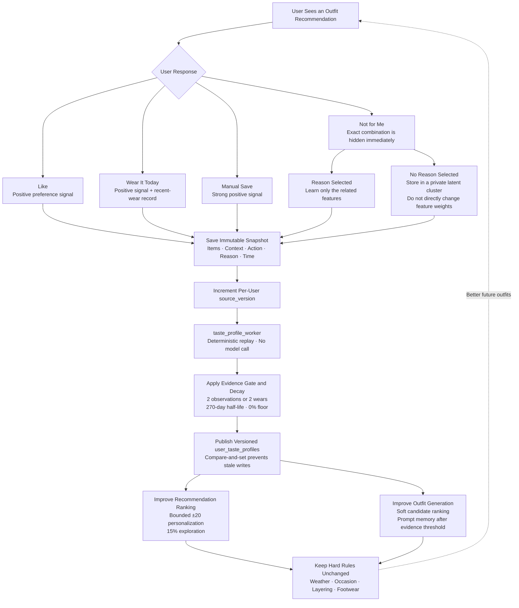

# Per-User Taste Learning and Outfit Personalization

AI Closet uses a deterministic, replayable feedback pipeline to personalize outfit generation and recommendation for each user. The system learns from explicit actions without fine-tuning a model, keeps every user’s profile isolated, and preserves the existing structural, weather, occasion, layering, and footwear rules as hard constraints.

## End-to-end flow

1. **Catalog and recognition.** Recognition uses the current user’s catalog and returns normalized category, subtype, color, style, occasion, season, material, pattern, fit, length, sleeve length, layering role, warmth, formality, and semantic vector. User-confirmed tags remain authoritative. Explicit occasion-to-style preferences are stored separately and apply immediately without waiting for learned evidence.
2. **Outfit generation.** The worker first excludes incompatible categories, weather or season combinations, invalid layering, unsuitable footwear, deleted items, and stale item revisions. It ranks the remaining candidate catalog with metadata, semantic vectors, compatibility priorities, and eligible per-user taste weights. The prompt explicitly defines structured Taste and summarized feedback as soft evidence that cannot override hard rules. The server converts the 15% exploration target to a discrete proposal count and rejects a response that misses that quota. The final image review also receives Taste, verifies any claimed alignment against the visible garments, and does not reject a coherent exploration merely because it is unfamiliar.
3. **Outfit library and recommendation.** Generated outfits that pass review and user-created outfits enter the user’s library. Recommendation removes exact disliked combinations, unavailable items, structurally invalid generated outfits, and items worn during the strict recent-wear window. It then combines the base semantic, occasion, weather, style, color, and completeness score with a bounded personalization score and the decaying wear penalty. A small exploration share prevents the ranking from becoming repetitive.
4. **Feedback capture.** `Like`, `Not for me`, `Wear it today`, and manually saved outfits write immutable snapshots of the items and context as they existed when the action occurred. This prevents later tag edits from rewriting the meaning of historical feedback. Exact Like/Dislike state remains queryable for library filtering and exact-combination handling.
5. **Taste projection.** Each new or removed learning source increments `user_taste_profiles.source_version`. The low-cost `taste_profile_worker` replays the user’s current feedback state, wear events, and personal outfits through the deterministic reducer. It publishes the result only when the source version still matches, so feedback arriving during projection cannot be overwritten by stale work. Recommendation requests can also project lazily when needed. A separate `free_text_taste_worker` wakes only after 10 unsummarized notes, merges at most 50 notes with the prior summary, and records model usage without rebuilding old outfits.
6. **Use and control.** The profile contains feature weights, evidence counters, positive and negative semantic centroids, generation memory, and version metadata. The iOS settings screen shows the learned preferences and avoidances and lets the user reset learned behavior without deleting clothes, catalog customizations, explicit style preferences, or exact saved outfits.

## Important decisions

- **Explicit settings outrank inferred behavior.** User-selected catalog values and occasion-specific styles are direct product settings. They do not decay and are never rewritten by the learner.
- **Hard compatibility remains deterministic.** Personalization can reorder valid candidates or add a bounded score. It cannot admit an invalid outfit or weaken temperature, occasion, layering, tights, shoe, ownership, or item-version checks.
- **Feedback is reason-scoped.** A color-related dislike updates color and pattern features; a weather dislike updates warmth and season features; an occasion dislike updates occasion relationships. `dislike_item` applies only to selected target items. This avoids turning one negative outfit into an unrelated global dislike.
- **A reasonless dislike has limited meaning.** It immediately hides the exact combination. It is also grouped into private per-user latent clusters, but those clusters do not directly affect feature weights, ranking, or generation. This protects the system from guessing why the user rejected an outfit.
- **Learning requires repeated evidence.** A single action does not reshape recommendations. Eligible features must cross the evidence gate before affecting ranking or generation.
- **Recent wear and long-term taste are separate.** Recent wear controls rotation and availability; the taste profile represents longer-term preferences. A positive taste score cannot bypass the two-day wear exclusion.
- **Free text is summarized asynchronously.** Submitting feedback makes no model call. At 10 pending notes, a separate worker produces a structured per-user summary in batches of at most 50. The summary excludes shoe, bag and accessory preferences, cannot alter hard rules, and is protected against instructions embedded in user text.
- **Cross-user learning is off by default.** Per-user learning is isolated. Anonymous global training may use a user’s data only after explicit training consent and is outside the v1 pipeline.
- **Learning is observable and reversible.** Profile versions and component scores support debugging and evaluation. Users can view or reset the learned profile.

## Current defaults

| Setting | Default |
|---|---:|
| Algorithm version | `taste-profile-v2` |
| Manually saved outfit signal | `+2.0` |
| Wear signal | `+1.5` |
| Like signal | `+1.0` |
| Reason-scoped Not for me signal | `-1.0` |
| Evidence required to affect ranking/generation | `2` observations |
| Alternative wear threshold | `2` wears |
| Maximum personalization adjustment | `±20` points |
| Exploration share | `15%` |
| Free-text summary threshold | `10 notes` |
| Maximum notes per summary call | `50` |
| Inferred-preference half-life | `270 days` |
| Inferred-preference minimum retained influence | `0%` |
| Prior strength | `2.5` |
| Personalization scale | `0.5` |
| Reasonless-dislike latent cluster threshold | `20` events |
| Strict recent-wear exclusion | `2 days` |
| Wear penalty immediately after exclusion | `40 points` |
| Wear-penalty half-life | `3 days` |
| Wear-penalty cutoff | `14 days` |
| Free-text model calls | `0` per feedback action; one asynchronous call after 10 pending notes |
| Cross-user learning | `Off unless explicitly consented` |

The result is a closed loop in which explicit preferences guide the system immediately, repeated behavior gradually changes soft ranking and generation context, exact negative feedback has immediate local effect, and the outfit safety and compatibility rules remain stable for every user.
